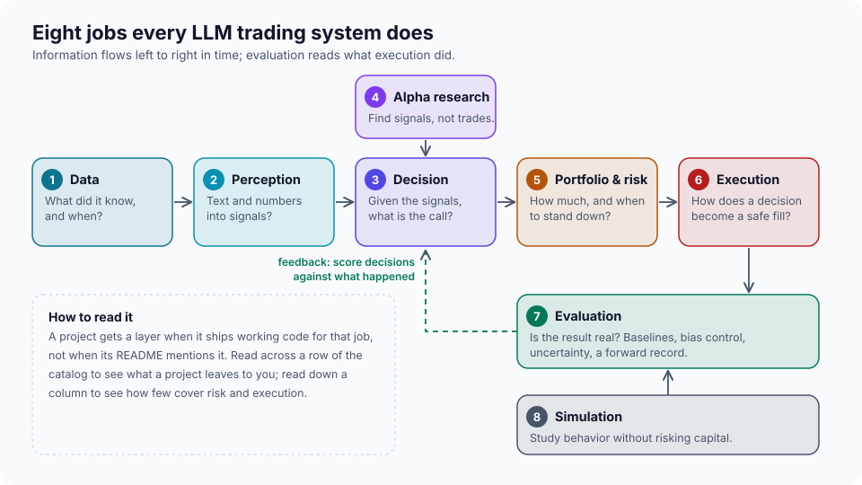

<p align="center"></p>

<p align="center"><b>English</b> · <a href="README.zh-CN.md">简体中文</a></p>

**Agentic Trading Atlas** maps LLM and agentic trading from first principles: what a trading system has to get right, how the published systems get it right or wrong, and how to compare them fairly. It is not a longer link list. Every paper and repository is graded, dated and checked by script, five systems are taken apart down to the code, and the places where claims and sources disagree are published.

<!-- atlas:headline -->57 papers, 39 projects, 5 teardowns<!-- /atlas:headline -->, one fair-evaluation design, one statistics toolkit. Snapshot: 2026-10-21 (US Pacific time).

> Research and education only. Nothing here is financial advice, and nothing here places an order.

## Three questions

| Question | Where it is answered |
|---|---|
| **What exists, and what is it doing?** | [Domain map](docs/01-domain-map.md): eight jobs every system does, and which projects do which. [Catalog](docs/catalog/projects.md): papers and projects with an evidence grade each. |
| **How does it really work, and what does the evidence show?** | [Five teardowns](docs/teardowns/) (architecture, data, decision loop, risk, evaluation, limits), [claim audit](docs/05-claim-audit.md), [how to read a backtest](docs/06-reading-a-backtest.md). |
| **How would we compare them fairly?** | [Same-budget evaluation](docs/04-fair-evaluation.md): same data, same model, same cost, a single-call baseline, an error bar. Code in [`tools/evalkit`](tools/evalkit/). |



## What we found

- **The four source lists barely overlap.** Together they link 584 repositories and 151 arXiv papers; no repository appears in all four lists, and one paper does (TradingAgents). A reader of one list sees a different field from a reader of another. [Details](docs/03-lists-compared.md).
- **No headline result has been independently reproduced.** No catalogued project reaches the third rung of the [evidence ladder](docs/02-evidence-ladder.md) on its main claim. In all three agentic systems we read that publish a trading table (TradingAgents, FinMem, ContestTrade), the code or data needed to regenerate it is missing from the repository ([audit items 3, 6 and 8](docs/05-claim-audit.md)).
- **Headline Sharpe ratios come from a few months.** A Sharpe measured over three months carries a standard error of about 2, and over six months about 1.4; a strategy whose true Sharpe is 1 needs close to three years of record to separate from zero. [The numbers](docs/06-reading-a-backtest.md).
- **Some results move when you check them.** An abstract that contradicts its own table; a headline taken from the best of three settings on the test window; a rerun on a different backbone that gives 19.9% where 61.8% was reported. [Claim audit](docs/05-claim-audit.md), with the version and commit read for each.
- **Architecture comparisons rarely control for spend.** TradingAgents' pipeline makes eleven or more calls per decision and is compared with rule-based baselines, not with one call to the same model; at the same model and prices that pipeline costs about fourteen times a single call (illustrative arithmetic, [section 3](docs/04-fair-evaluation.md#3-budget-tiers)). A same-budget design with a single-call control fixes that.
- **Live records are scarce and sobering.** The catalog's forward-record projects are author-run and short, and one of them publishes its own verdict of no measured edge over 55 forward-settled trades.

## Read in this order

| | Page | One line |
|---|---|---|
| 0 | [First principles](docs/00-first-principles.md) | Seven statements any trading system, LLM or not, has to satisfy. |
| 1 | [Domain map](docs/01-domain-map.md) | Eight layers, who does what. |
| 2 | [Evidence ladder](docs/02-evidence-ladder.md) | L0 to L4: how far someone else can inspect a claim. |
| 3 | [Lists compared](docs/03-lists-compared.md) | Why a fifth list is not the answer. |
| 4 | [Fair evaluation](docs/04-fair-evaluation.md) | Frozen world, equal budget, single-call baseline, report card. |
| 5 | [Claim audit](docs/05-claim-audit.md) | What did not line up, neutrally stated. |
| 6 | [Reading a backtest](docs/06-reading-a-backtest.md) | Error bars, record length, selection bias. |
| 7 | [Methodology](docs/07-methodology.md) | How the catalog was built, what is checked by program. |
| | [Teardowns](docs/teardowns/) | [TradingAgents](docs/teardowns/tradingagents.md) · [FinRobot](docs/teardowns/finrobot.md) · [FinMem](docs/teardowns/finmem.md) · [ContestTrade](docs/teardowns/contesttrade.md) · [FinRL-X](docs/teardowns/finrl-x.md) |
| | Catalog | [Papers](docs/catalog/papers.md) · [Projects](docs/catalog/projects.md) · [Method cards](docs/cards/index.md) |

## Use the tools

Python 3.11 or newer. Everything except the card-extraction step uses only the standard library.

```bash
python -m unittest discover -s tests -t .       # tests, including simulations that check the statistics
python tools/atlas.py check                     # validate the catalog
python tools/verify.py all                      # re-resolve every arXiv id and repository (needs network)

python -m tools.evalkit se --sr 5.6 --years 0.25            # standard error of a reported Sharpe
python -m tools.evalkit min-record --sr 1.0                 # years of record before a Sharpe separates from zero
python -m tools.evalkit diff-years --delta 0.5 --sr-low 0.5 --rho 0.9   # years to tell two agents apart
python -m tools.evalkit card-template                       # the report card every evaluation should publish
```

The method cards are produced by [`tools/extract`](tools/extract/), which calls the Claude API once per paper and keeps only the fields whose quotes a program found in the paper text.

## Repository layout

```
catalog/    papers.toml, projects.toml, excluded.toml: the source of truth
docs/       the pages above; docs/catalog and docs/cards are generated
cards/      machine-extracted method cards (JSON)
tools/      atlas.py (validate and render), verify.py, list_audit.py, evalkit/, extract/
tests/      unit tests and documentation link checks
assets/     figures, generated by tools/make_assets.py
```

## Contributing and corrections

Corrections are the most useful contribution: a link that moved, a finding that a later version fixed, a project we mis-graded. See [CONTRIBUTING.md](CONTRIBUTING.md). Every claim in the audit names the version or commit it was read from, so it can be rechecked.

## License

MIT, see [LICENSE](LICENSE). Papers and repositories linked here keep their own licenses; the method cards store short quotes and hashes, not paper text.
