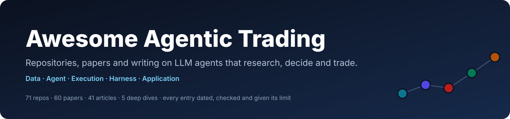
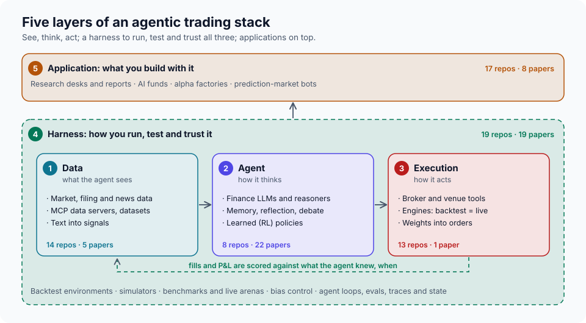

<p align="center"></p>

<p align="center">
  <a href="https://awesome.re"></a>
  <a href="https://github.com/orangejustin/awesome-agentic-trading/actions/workflows/ci.yml"></a>
  <a href="https://github.com/orangejustin/awesome-agentic-trading/actions/workflows/verify.yml"></a>
  <a href="LICENSE"></a>
  <a href="CONTRIBUTING.md"></a>
</p>

<p align="center"><b>English</b
> A curated, source-checked guide to building and evaluating **LLM-powered trading systems**: repositories, papers, articles and posts, organized by the five layers of the stack: **Data → Agent → Execution → Harness → Application**.

<!-- gen:headline -->62 repositories (50 open source · 4 mixed or restricted license · 8 license unclear) · 59 papers · 41 articles and posts · 5 deep dives<!-- /gen:headline -->. Every repository entry says what it does, whether it can place orders, how it is licensed and its most important limit; every paper says how much of it we actually read.

**What "checked" means.** Each repository was read at a named commit: its README, its license file and the lines that decide whether it can place orders. That is a *source check*. Installing a project and running it end to end are stronger claims, made only where a page says so ([component matrix](docs/components.md)). A program re-checks every link weekly ([latest report](https://github.com/orangejustin/awesome-agentic-trading/actions/workflows/verify.yml)); the check date on an entry is the day a person last read it, and no program moves it.

> [!WARNING]
> Research and education only. Nothing here is financial advice. Several listed tools can place real orders (marked ⚡, linked to the lines that show it); start them read-only or on a paper account where one exists. Inclusion does not mean a project is profitable or production-ready.


## Contents

- [Start here](#start-here)
- [The stack](#the-stack)
- [What the evidence shows](#what-the-evidence-shows)
- [Recent milestones](#recent-milestones)
- [Directory](#directory): [Data](#1-data-layer-what-the-agent-sees) · [Agent](#2-agent-layer-how-it-thinks) · [Execution](#3-execution-layer-how-it-acts) · [Harness](#4-harness-layer-how-you-run-test-and-trust-it) · [Application](#5-application-layer-what-you-build-with-it)
- [Surveys](#surveys)
- [Guides and deep dives](#guides-and-deep-dives)
- [Lab](#lab)
- [Related lists](#related-lists)
- [How this list is curated](#how-this-list-is-curated)
- [Contributing](#contributing)

## Start here

| You want to | Start with | Layer |
|---|---|---|
| Research a company and write a report whose numbers come from code | [FinRobot](https://github.com/AI4Finance-Foundation/FinRobot) | Application |
| Study a multi-agent "trading firm" that debates a stock | [TradingAgents](https://github.com/TauricResearch/TradingAgents), [ContestTrade](https://github.com/FinStep-AI/ContestTrade) | Agent |
| Experiment with investor agents in a simulated fund | [AI Hedge Fund](https://github.com/virattt/ai-hedge-fund) | Application |
| Automate factor and model research | [RD-Agent](https://github.com/microsoft/RD-Agent) on [Qlib](https://github.com/microsoft/qlib) | Application, Harness |
| Give an agent market data | [OpenBB](https://github.com/openbq-org/OpenBB), [Yahoo Finance MCP](https://github.com/Alex2Yang97/yahoo-finance-mcp), [Massive MCP Server](https://github.com/massive-com/mcp_massive) | Data |
| Let an agent place orders, safely first | [Alpaca MCP Server](https://github.com/alpacahq/alpaca-mcp-server) (paper by default), [tastytrade MCP](https://github.com/tastytrade/tastytrade-mcp) (read-only or sandbox mode), [CCXT](https://github.com/ccxt/ccxt) (ccxt-mcp: trading tiers off until you enable them) | Execution |
| Pick parts that fit together for your own build | [Component matrix](docs/components.md): language, runtime, interface, inputs and outputs, keys and cost, order authority | All |
| Backtest and trade with a mature engine | [LEAN](https://github.com/QuantConnect/Lean), [NautilusTrader](https://github.com/nautechsystems/nautilus_trader) | Execution |
| Benchmark or stress-test a trading agent | [DeepFund](https://github.com/HKUSTDial/DeepFund), [Live Trade Bench](https://github.com/ulab-uiuc/live-trade-bench), [TradeTrap](https://github.com/Yanlewen/TradeTrap) | Harness |
| See a real forward record, good or bad | [Kalshi AI Trading Bot](https://github.com/ryanfrigo/kalshi-ai-trading-bot) (publishes its own "no measured edge" verdict), [LLM Trading Lab](https://github.com/LuckyOne7777/LLM-Trading-Lab) | Harness |
| Judge a backtest someone shows you | [Reading a backtest](docs/06-reading-a-backtest.md) and the [evaluation kit](#lab) | Harness |

## The stack

<p align="center"></p>

Data, Agent and Execution are the pipeline: see, think, act. The Harness wraps all three: it is how you run, test and trust them. Applications sit on top. Each layer has its own page with every repository, paper, article and post, the evidence behind each mark, the failure modes to watch, and builder notes. [How entries are placed →](layers/README.md#how-entries-are-placed)

<!-- gen:stack -->
| Layer | The question it answers | Repos | Papers | Articles |
|---|---|---|---|---|
| [1. Data layer](layers/data.md) | What did the agent know, and when did it know it? | 13 | 5 | 6 |
| [2. Agent layer](layers/agent.md) | Given the signals, what is the call, and how is it argued? | 8 | 22 | 3 |
| [3. Execution layer](layers/execution.md) | How does a decision become a fill, safely? | 10 | 1 | 7 |
| [4. Harness layer](layers/harness.md) | Is the result real, and would we notice if it stopped being real? | 18 | 18 | 15 |
| [5. Application layer](layers/application.md) | What end-to-end job does it do for a user? | 13 | 8 | 10 |
<!-- /gen:stack -->

## What the evidence shows

- **We could not regenerate any headline trading result.** At the commits we inspected, the three agentic systems we read that publish a trading table (TradingAgents, FinMem, ContestTrade) do not ship the complete code and data needed to reproduce it. That describes those repositories at those commits, not everything anyone has tried: the one independent rerun we know of, FINSABER's of FinMem, found much lower returns ([claim audit](docs/05-claim-audit.md)).
- **Headline Sharpe ratios come from a few months.** Three months of data leaves an error of about ±2 on a Sharpe ratio; a strategy with a true Sharpe of 1 needs close to three years to separate from zero ([reading a backtest](docs/06-reading-a-backtest.md)).
- **Architecture comparisons rarely control for spend.** TradingAgents makes eleven or more model calls per decision and is compared with rule-based baselines, not with one call to the same model ([fair evaluation](docs/04-fair-evaluation.md)).
- **The popular lists barely overlap.** Four of them link 584 repositories between them, and none appears in all four ([lists compared](docs/03-lists-compared.md)).

## Recent milestones

<!-- gen:recent -->
- **2026-07** · [Interactive Brokers opens its MCP server to any client](https://fxnewsgroup.com/forex-news/retail-forex/interactive-brokers-enables-traders-to-connect-their-accounts-to-any-mcp-compatible-ai-application/): A global broker made its remote MCP server available to any compatible agent, with OAuth consent and revocation. Trade-press source.
- **2026-05** · [Robinhood opens live trading to agents](https://robinhood.com/newsroom/robinhood-is-now-open-to-agents/): A large retail broker gave third-party agents official order access through MCP, with a ring-fenced account, previews and kill switches: order authority became a product feature.
- **2025-12** · [FINRA addresses AI agents in its oversight report](https://www.finra.org/rules-guidance/guidance/reports/2026-finra-annual-regulatory-oversight-report/gen-ai): A US regulator defined AI agents and listed the risks firms must supervise (autonomy, authority, auditability), turning harness design into a compliance question.
- **2025-10** · [Alpha Arena: LLMs trade real money in public](https://x.com/jay_azhang/status/1979312946154033227): Six models with $10K each traded crypto perpetuals autonomously in public; Qwen 3 MAX finished first on 2025-11-03. It made live records mainstream, and showed how short one run is.
<!-- /gen:recent -->

[Full timeline, from FinRL (2020) to today →](docs/milestones.md)

## Directory

Every listed repository, by layer. One line each: what it is, then ⚠️ the limit most likely to change your decision. The commit we checked, the check date and the license evidence for each entry are on its layer page.

**Legend:** ⚡ can place real orders · 📝 paper trading only (both link to the lines that show it) · 🟡 slowing · ⚪ dormant: last commit more than 90 days, or more than a year, before the check date · 💤 the authors say it is no longer maintained · 🧩 open core with proprietary parts · 🔒 source-available, restricted · ❓ license unclear · 🧰 general-purpose tool used for this job · 🔬 our deep dive. No mark means active and openly licensed. Within a category, finance-specific projects come first and general-purpose tools (🧰) last; each group is ordered by GitHub stars where we recorded them, a popularity signal, not a quality score.

<!-- gen:directory -->
### 1. Data layer: what the agent sees

> What did the agent know, and when did it know it?

**13 repos · 5 papers · 6 articles** · [Layer page: evidence links, check dates, every paper →](layers/data.md)

#### Market and fundamental data

- [OpenBB](https://github.com/openbq-org/OpenBB) — Open data-integration platform serving market and economic data to Python and agents. ⚠️ Data access only; point-in-time correctness is up to you.
- [TradingView-API](https://github.com/Mathieu2301/TradingView-API) ❓ `ISC` — Unofficial TypeScript client for TradingView candles, indicators, screener and replay, with a look-ahead-guarded backtest module. ⚠️ Unofficial, undocumented endpoints with Terms-of-Use risk; no root LICENSE file (package.json says ISC)
- [AKShare](https://github.com/akfamily/akshare) 🧰 — Public Chinese and global market, macro and news data into pandas, with an llms.txt for LLMs. ⚠️ Scraped endpoints break when sites change; current data, not point-in-time; MCP and HTTP access come from the separate AKTools project.

#### Filings, news and text

- [edgartools](https://github.com/dgunning/edgartools) — SEC EDGAR filings as typed Python objects and DataFrames, with an MCP server for agents. ⚠️ US SEC filers only; requests need a contact identity and respect SEC rate limits.
- [FNSPID](https://github.com/Zdong104/FNSPID_Financial_News_Dataset) [💤](https://github.com/Zdong104/FNSPID_Financial_News_Dataset/blob/4054842ec476953b30ee874d4b7e8eea786a21fa/README.md?plain=1#L3) 🔒 `CC-BY-NC-4.0` — Time-aligned financial news and prices for 4,775 S&P 500 companies, 1999-2023. ⚠️ Data ends in 2023; license file (CC BY-NC) conflicts with a README note; no longer maintained.
- [Agent-Reach](https://github.com/Panniantong/Agent-Reach) 🧰 — CLI that gives a coding agent read access to X, Reddit, Xiaohongshu, Xueqiu, video subtitles and more. ⚠️ Reuses browser login cookies (use a secondary account); platform-terms risk; health check is not proof of correct data.
- [OpenCLI](https://github.com/jackwener/OpenCLI) 🧰 — Browser-automation CLI that turns websites into JSON commands for agents, through your logged-in Chrome. ⚠️ Runs with your logged-in account's privileges; adapters break when sites change; whitelist read-only commands.
- [Trafilatura](https://github.com/adbar/trafilatura) 🧰 — Extracts the main text and metadata (title, author, date) from news and filing pages. ⚠️ Extraction only: no login or JavaScript rendering; site terms still apply.

#### Data servers for agents (MCP)

- [Financial Datasets MCP Server](https://github.com/financial-datasets/mcp-server) ⚪ — MCP server exposing Financial Datasets API financials, prices and company news. ⚠️ Requires a Financial Datasets API key; last commit 2025-06-05.
- [Massive MCP Server](https://github.com/massive-com/mcp_massive) — First-party MCP server exposing the Massive (formerly Polygon.io) market-data API. ⚠️ Marked experimental by its authors and requires a Massive API key.
- [Yahoo Finance MCP](https://github.com/Alex2Yang97/yahoo-finance-mcp) — MCP server giving LLM clients Yahoo Finance prices, statements, options and news. ⚠️ Wraps yfinance current data, not point-in-time; unsuitable for backtesting.
- [TradingView MCP (Desktop)](https://github.com/tradesdontlie/tradingview-mcp) — MCP server that lets an agent read and drive your local TradingView Desktop: charts, indicators, Pine Script, alerts. ⚠️ Drives the desktop app through undocumented APIs (ToS risk); start read-only; maintained fork: iliaal/tradingview-mcp.

#### Data validation and evidence records

- [pandera](https://github.com/unionai-oss/pandera) 🧰 — Schema and statistical checks for dataframes: fail fast on missing bars, bad types or out-of-range prices. ⚠️ Checks structure and values only; it cannot detect look-ahead, survivorship or stale data by itself.

#### Essential reading

- [Can ChatGPT Forecast Stock Price Movements? Return Predictability and Large Language Models](https://arxiv.org/abs/2304.07619) — Alejandro Lopez-Lira et al., 2023 · 🗂️ method card. Scores news headlines with ChatGPT/GPT-4 and tests the scores against next-day returns, using post-cutoff headlines; reports predictability that fades as LLM adoption rises.
- [FNSPID: A Comprehensive Financial News Dataset in Time Series](https://arxiv.org/abs/2402.06698) — Zihan Dong et al., 2024 · 🗂️ method card. FNSPID: financial news dataset aligned in time with stock prices, for text-plus-numbers prediction.
- 📘 [TradingView MCP Server FAQ](https://www.tradingview.com/support/solutions/43000795700-mcp-server-faq/) — TradingView, undated (checked 2026-10-26). Read before wiring it into an agent: data is delayed even with a real-time subscription, Pine and indicator alerts are not in the beta, and unattended or server-hosted use is out of scope. It suits interactive research, not an unattended data feed.

### 2. Agent layer: how it thinks

> Given the signals, what is the call, and how is it argued?

**8 repos · 22 papers · 3 articles** · [Layer page: evidence links, check dates, every paper →](layers/agent.md)

#### Finance foundation and reasoning models

- [FinGPT](https://github.com/AI4Finance-Foundation/FinGPT) — Open financial LLM project with data pipelines and LoRA fine-tuning recipes. ⚠️ A model and data project; no trading-performance claim checked.
- [Qwen DianJin](https://github.com/aliyun/qwen-dianjin) — Alibaba Cloud hub for finance reasoning models, datasets and benchmarks. ⚠️ A research hub, not a trading system; sub-projects have separate READMEs and licenses.
- [Kronos](https://github.com/shiyu-coder/Kronos) 🟡 — Foundation model for candlestick (OHLCV) sequences, with released checkpoints and fine-tuning scripts. ⚠️ Research-grade forecasts; compare out of sample against simple baselines and a random walk before use.

#### Multi-agent decision architectures

- [TradingAgents](https://github.com/TauricResearch/TradingAgents) [🔬](docs/teardowns/tradingagents.md) — LangGraph multi-agent trading firm whose analyst and risk debates yield five-tier ratings. ⚠️ Evaluates decision quality only; no portfolio simulator, Sharpe code or paper harness.
- [QuantAgent / QuantHarness](https://github.com/Y-Research-SBU/QuantHarness) — LangGraph multi-agent technical-analysis system for short-horizon trading with web UI. ⚠️ Paper backtest not rerun; short-horizon results need long records.
- [ContestTrade](https://github.com/FinStep-AI/ContestTrade) 🟡 [🔬](docs/teardowns/contesttrade.md) — Multi-agent framework where competing teams build text factors and trades, weighted by predicted Sharpe. ⚠️ Repo lacks backtest code, so the paper's Table 1 cannot be regenerated.

#### Single agents, memory and reflection

- [FinMem](https://github.com/pipiku915/FinMem-LLM-StockTrading) ⚪ [🔬](docs/teardowns/finmem.md) — Single LLM trading agent with risk persona and three-layer decaying memory. ⚠️ Repo ships no market data, only placeholders and a fake sample zip.

#### Reinforcement learning and learned policies

- [FinRL](https://github.com/AI4Finance-Foundation/FinRL) [⚡](https://github.com/AI4Finance-Foundation/FinRL/blob/7e98df461cbc7772f16a545a2f13b521e5d0b8f4/README.md?plain=1#L55) — Deep reinforcement learning library and tutorials for stock trading environments. ⚠️ Teaching-oriented RL environments with basic Alpaca live trading; FinRL-X is the production successor.

#### Essential reading

- [FinMem: A Performance-Enhanced LLM Trading Agent with Layered Memory and Character Design](https://arxiv.org/abs/2311.13743) — Yangyang Yu et al., 2023 · 📖 read in full. Single trading agent with three decaying memory tiers (news / 10-Q / 10-K) and risk-persona prompts. Tests five tickers over roughly six months.
- [FinCon: A Synthesized LLM Multi-Agent System with Conceptual Verbal Reinforcement for Enhanced Financial Decision Making](https://arxiv.org/abs/2407.06567) — Yangyang Yu et al., 2024 · 🗂️ method card. Manager-analyst hierarchy plus a risk-control component whose episodic self-critique is fed back as 'conceptual verbal reinforcement'.
- [TradingAgents: Multi-Agents LLM Financial Trading Framework](https://arxiv.org/abs/2412.20138) — Yijia Xiao et al., 2024 · 📖 read in full. Role-based LLM 'trading firm': analysts, bull/bear debate, trader, risk debate, portfolio manager. Reports a Jan-Mar 2024 backtest on a few US tech stocks.
- 🎤 [How Bridgewater's AIA Labs Built PAT: The AI Pocket Analyst Tool](https://www.bridgewater.com/aia-labs/how-bridgewaters-aia-labs-built-pat-the-ai-pocket-analyst-tool) — Brendan McManus, Michael Ran, Santi Weight (Bridgewater AIA Labs), 2026-05. A rare engineering talk from a large macro fund on combining codified investment knowledge with agentic LLM workflows and investor feedback loops.

### 3. Execution layer: how it acts

> How does a decision become a fill, safely?

**10 repos · 1 papers · 7 articles** · [Layer page: evidence links, check dates, every paper →](layers/execution.md)

#### Broker and venue tools for agents

- [CCXT (with ccxt-mcp)](https://github.com/ccxt/ccxt) [⚡](https://github.com/ccxt/ccxt/blob/e1579cb6bf5519fe588e249fd60fc42d5fff8f8c/mcp/README.md?plain=1#L16-L22) — Unified API for 100+ crypto exchanges, now with an official MCP server built around guardrails. ⚠️ MCP server is early; trading tiers live in a local config that also holds API keys.
- [AgentKit](https://github.com/coinbase/agentkit) [⚡](https://github.com/coinbase/agentkit/blob/f2f3e8c11a91d56a17979a229a172ba6e61a85c2/README.md?plain=1#L200-L204) — Gives an AI agent a crypto wallet and onchain actions: transfers, swaps, payments. ⚠️ No built-in approval, spend cap or allowlist: a prompt injection can move funds; add guardrails first.
- [Alpaca MCP Server](https://github.com/alpacahq/alpaca-mcp-server) [⚡](https://github.com/alpacahq/alpaca-mcp-server/blob/63cc4278d87b31f3ed4efcfaa55624095c6d7be8/README.md?plain=1#L245-L258) — MCP server letting LLM clients query market data and place Alpaca orders. ⚠️ Paper by default, but one flag switches to live orders; all toolsets on unless restricted.
- [Polymarket MCP Server](https://github.com/caiovicentino/polymarket-mcp-server) [⚡](https://github.com/caiovicentino/polymarket-mcp-server/blob/21f65f319ff0fc4250ea1e5094581761906839e1/README.md?plain=1#L184-L195) — MCP server exposing 45 tools for Polymarket discovery, trading and monitoring. ⚠️ Full mode trades real funds from a wallet; DEMO mode is read-only; Polymarket has no paper account.
- [fintool](https://github.com/second-state/fintool) [⚡](https://github.com/second-state/fintool/blob/177a9b8e3a09e507cdb2c8458f2be4b9574abaaf/README.md?plain=1#L86-L97) 🟡 ❓ `MIT` — Rust CLI suite giving agents per-venue trading binaries plus market data. ⚠️ Holds order authority on live venues; start with small size or testnet.
- [Schwab MCP](https://github.com/jkoelker/schwab-mcp) [⚡](https://github.com/jkoelker/schwab-mcp/blob/491960670d98dad9ed26f6631536b2db656f51be/README.md?plain=1#L133-L151) — Community MCP server for Charles Schwab: quotes, option chains, positions and orders with human approval. ⚠️ Unofficial; real-account orders once approved; needs a Schwab developer app.
- [tastytrade MCP](https://github.com/tastytrade/tastytrade-mcp) [⚡](https://github.com/tastytrade/tastytrade-mcp/blob/7f2bb636a8a1906fecc28f5da27ab382dd966941/README.md?plain=1#L10-L19) — tastytrade's official MCP server: quotes, option chains, positions and order entry. ⚠️ Defaults to production (real money); start in read-only or sandbox mode.

#### Trading engines (same code in backtest and live)

- [NautilusTrader](https://github.com/nautechsystems/nautilus_trader) [⚡](https://github.com/nautechsystems/nautilus_trader/blob/a8786259f83c9787293adc456444bfd38c361df6/README.md?plain=1#L64) — Event-driven engine running the same strategy code in backtest and live. ⚠️ General engine, not LLM-specific; agent integration is up to you.
- [LEAN](https://github.com/QuantConnect/Lean) [⚡](https://github.com/QuantConnect/Lean/blob/3afb212b30eff5e73013b5130887a95bf9e4cb4b/readme.md?plain=1#L97) — Event-driven algorithmic trading engine for research, backtesting and live trading. ⚠️ General engine, not LLM-specific; agent integration is up to you.

#### From target weights to orders

- [FinRL-X (FinRL-Trading)](https://github.com/AI4Finance-Foundation/FinRL-Trading) [⚡](https://github.com/AI4Finance-Foundation/FinRL-Trading/blob/4409abe925c904e570be78ebfb5e77ac3491dff8/README.md?plain=1#L61) [🔬](docs/teardowns/finrl-x.md) — Weight-centric pipeline that backtests target weights and sends them to a broker. ⚠️ RL allocator barely beats equal-weight; both trail QQQ without timing overlay.

#### Essential reading

- [FinRL-X: An AI-Native Modular Infrastructure for Quantitative Trading](https://arxiv.org/abs/2603.21330) — Hongyang Yang et al., 2026 · 📖 read in full. FinRL-X: weight-centric pipeline (selection, allocation, timing, risk overlay) shared by backtest and broker execution; 2018-2025 backtest plus 4.5-month paper trading.
- 📝 [Robinhood is Now Open to Agents](https://robinhood.com/newsroom/robinhood-is-now-open-to-agents/) — Robinhood, 2026-05. A large US retail broker gives third-party agents live trading through official MCP servers, using a ring-fenced agentic account, trade previews and kill switches: a reference design for order authority.

### 4. Harness layer: how you run, test and trust it

> Is the result real, and would we notice if it stopped being real?

**18 repos · 18 papers · 15 articles** · [Layer page: evidence links, check dates, every paper →](layers/harness.md)

#### Research and backtest environments

- [Qlib](https://github.com/microsoft/qlib) — Quant research platform with data layer, ML model zoo and backtest tooling. ⚠️ General quant platform; the LLM agent layer is up to you.
- [Agentic Trading Lab](https://github.com/Open-Finance-Lab/AgenticTrading) [⚡](https://github.com/Open-Finance-Lab/AgenticTrading/blob/e27b5eb141265df618a228a99aab41b3b97e9767/dashboard/backend/api/routers/robinhood_live.py#L1-L5) — Research platform to build, backtest and paper-trade LLM trading agents. ⚠️ Real-money Robinhood path ships switched off; uncommon OpenMDW-1.0 license.

#### Simulators and paper-trading gyms

- [FinRL-Meta](https://github.com/AI4Finance-Foundation/FinRL-Meta) [⚡](https://github.com/AI4Finance-Foundation/FinRL-Meta/blob/286fef6c828a02a2ccf807c05b292d8cb28f8e95/README.md?plain=1#L132) — Gym-style market environments and benchmarks for financial reinforcement learning. ⚠️ Built for RL, not LLM agents; paper-trading envs hit Alpaca's paper endpoint by default.
- [StockAgent](https://github.com/MingyuJ666/Stockagent) 🟡 ❓ no license — Simulated stock exchange where LLM investors trade under external factors. ⚠️ No LICENSE file in the repo, so reuse terms are unclear.
- [polymarket-paper-trader](https://github.com/agent-next/polymarket-paper-trader) [📝](https://github.com/agent-next/polymarket-paper-trader/blob/55bb35b7956815c71f5fb58292b2d1e859abff05/README.md?plain=1#L13) — Paper-trading gym for agents on live Polymarket order books with MCP server. ⚠️ Prediction markets only, not equities; fill-fidelity claim is the author's own.

#### Benchmarks, arenas and forward records

- [AI-Trader](https://github.com/HKUDS/AI-Trader) [📝](https://github.com/HKUDS/AI-Trader/blob/d03ff6c056b32ced735adf7c19ed8175adb1c8df/README.md?plain=1#L119) 🟡 ❓ `MIT` — Agent-native trading platform and live leaderboard where outside AI agents trade. ⚠️ No LICENSE file at repo root; MIT stated only in README badge.
- [LLM Trading Lab](https://github.com/LuckyOne7777/LLM-Trading-Lab) 🟡 ❓ no license — Logged six-month live experiment of ChatGPT managing a real-money micro-cap portfolio. ⚠️ One six-month run, author-evaluated; no broker integration in the code; no license file.
- [PIXIU / FinBen](https://github.com/The-FinAI/PIXIU) — Open financial LLM FinMA with instruction data and FinBen evaluation suite. ⚠️ High scores on these tasks say little about trading performance.
- [DeepFund](https://github.com/HKUSTDial/DeepFund) 🟡 — Live arena benchmarking LLM fund managers on post-cutoff market data. ⚠️ Does not trade (decisions are scored on live data); results depend on a short live window.
- [Live Trade Bench](https://github.com/ulab-uiuc/live-trade-bench) [📝](https://github.com/ulab-uiuc/live-trade-bench/blob/05fbfec8df76c2c309201e6b4b7c26aff7e6d0f9/README.md?plain=1#L64-L71) 🟡 🔒 `PolyForm-Noncommercial-1.0.0` — FastAPI platform running and monitoring LLM trading agents live on stocks and Polymarket. ⚠️ Simulated portfolios on live data, not real capital; noncommercial license.

#### Robustness and bias control

- [TradeTrap](https://github.com/Yanlewen/TradeTrap) 🟡 — Fault-injection toolkit testing LLM trading agents against attacks and data manipulation. ⚠️ Measures robustness, not profitability.

#### Agent harness: loops, evals, traces and state

- [Harbor](https://github.com/harbor-framework/harbor) 🧰 — Containerized agent evaluation: tasks, independent verifiers that write rewards, benchmarks and RL rollouts. ⚠️ Market data and simulators must be packaged as container tasks; cloud sandboxes cost money.
- [Harness²](https://github.com/google-research/harness2) 🧰 — Research framework that tunes an agent's harness (prompts, tools, memory, skills) per task with weights fixed. ⚠️ Research code evaluated on non-trading benchmarks; keep a held-out set the loop never sees.
- [Langfuse](https://github.com/langfuse/langfuse) 🧩 `MIT + proprietary ee/` 🧰 — Self-hostable tracing, prompt management and evals for LLM apps and agents. ⚠️ ee/ directories are under a separate license; self-hosting needs several services.
- [learn-claude-code](https://github.com/shareAI-lab/learn-claude-code) 🧰 — Step-by-step tutorial that builds a small coding-agent harness from scratch in Python. ⚠️ Teaching code, not production; not affiliated with Anthropic.
- [Pi (with Pi Durable)](https://github.com/earendil-works/pi) 🧰 — Minimal, hackable TypeScript agent harness; Pi Durable checkpoints each step so runs resume after a crash. ⚠️ Durable package is experimental; resuming a step is not reconciliation of real side effects.
- [promptfoo](https://github.com/promptfoo/promptfoo) 🧰 — Declarative evals and red-teaming for prompts and agents, run in CI. ⚠️ Generic LLM evals: trading graders, market fixtures and P&L-aware metrics are yours to write.
- [Single Agent Loop Kit](https://github.com/anthropics/single-agent-loop-kit) [💤](https://github.com/anthropics/single-agent-loop-kit/blob/c43796287b83bec847db923f07131d1cc8de750d/README.md?plain=1#L11) 🧰 — Reference kit for measuring a multi-agent system and folding subagents into one loop under evals. ⚠️ Unmaintained reference implementation; the example is customer support, not trading.

#### Essential reading

- [Can LLM-based Financial Investing Strategies Outperform the Market in Long Run?](https://arxiv.org/abs/2505.07078) — Weixian Waylon Li et al., 2025 · 📖 read in part. FINSABER: bias-aware backtester (survivorship, look-ahead, data snooping) run over two decades and 100+ symbols; earlier LLM advantages shrink.
- [Time Travel is Cheating: Going Live with DeepFund for Real-Time Fund Investment Benchmarking](https://arxiv.org/abs/2505.11065) — Changlun Li et al., 2025 · 🗂️ method card. DeepFund: live fund arena using only data published after each model's cutoff; reports that even strong models (DeepSeek-V3, Claude-3.7-Sonnet) lose money in its live run.
- [Detecting Lookahead Bias in LLM Forecasts](https://arxiv.org/abs/2512.23847) — Zhenyu Gao et al., 2025 · 🗂️ method card. Lookahead Propensity (LAP): date-only recall query that estimates how much an LLM has memorized an outcome; used to test forecast contamination.
- 𝕏 [Season 1 of Alpha Arena has officially ended](https://x.com/jay_azhang/status/1985481491078328621) — Jay A. Zhang (@jay_azhang, Nof1), 2025-11. Results post that names the design limits shaping the outcome: numeric time-series-only context, a narrow asset universe, a limited action space, persistent model "personalities". Two weeks of one run cannot separate skill from luck.
- 📝 [Effective harnesses for long-running agents](https://www.anthropic.com/research/effective-harnesses-for-long-running-agents) — Justin Young (Anthropic), 2025-11. An initializer agent sets up the scaffolding; a worker agent does one unit per session, tests end to end, and leaves git history and progress notes for the next session. The same pattern fits multi-day research and strategy builds.
- 📝 [Your LLM's Alpha Might Be Mere Memorization](https://hedgefundalpha.com/education/your-llms-alpha-might-be-mere-memorization/) — Greg Kapoustin (Hedge Fund Alpha), 2026-04. Practitioner essay: LLM backtest edges often vanish after the training cutoff, so point-in-time integrity has to cover the model as well as the data.
- 📝 [Building agents: When to fold subagents into your main agent loop](https://claude.com/resources/articles/building-agents-when-to-fold-subagents-into-your-main-agent-loop) — Diane Sarkis (Anthropic), 2026-10. Many agents do better as one loop with skills loaded on demand than as a coordinator with many subagents. Keep subagents for context isolation, parallel independent work or conflicting instructions, and migrate under evals. Directly relevant to analyst/risk/trader agent teams.

### 5. Application layer: what you build with it

> What end-to-end job does it do for a user?

**13 repos · 8 papers · 10 articles** · [Layer page: evidence links, check dates, every paper →](layers/application.md)

#### Research desks and reports

- [Dexter](https://github.com/virattt/dexter) ❓ `MIT` — Autonomous research agent that plans, calls financial-data tools, checks its own work and iterates. ⚠️ Research only; needs a paid data API; no LICENSE file although the README says MIT.
- [FinRobot](https://github.com/AI4Finance-Foundation/FinRobot) [🔬](docs/teardowns/finrobot.md) — Equity-research agent platform where code computes figures and LLMs write narrative. ⚠️ Research workstation, not a trading system; no trading-performance claim to test.
- [Trading-R1](https://github.com/TauricResearch/Trading-R1) — Terminal research agent with market-data, web and valuation tools, PDF reports and scheduled briefs. ⚠️ Data tools need a Tauric key and sessions sync to Tauric by default; no weights, training code or backtest for the paper's model.
- [OpenTerminalUI](https://github.com/Hitheshkaranth/OpenTerminalUI) [📝](https://github.com/Hitheshkaranth/OpenTerminalUI/blob/48912fb420b1d16d6e412e9dec69871b242b93b2/README.md?plain=1#L187) — Self-hosted research terminal with an AI analyst that cites filings and labels where each number came from. ⚠️ Small single-maintainer project; free data may be delayed or synthetic (labelled); paper actions only.

#### AI funds and portfolio managers

- [AI Hedge Fund](https://github.com/virattt/ai-hedge-fund) [📝](https://github.com/virattt/ai-hedge-fund/blob/5c553b5222044f6a5527bd377b4104c50ee0ad28/README.md?plain=1#L57) — LLM investor agents run paper funds on real market days, with historical backtest replay. ⚠️ Educational per its own disclaimer; paper funds only, no real orders; results not rerun.
- [Vibe-Trading](https://github.com/HKUDS/Vibe-Trading) [⚡](https://github.com/HKUDS/Vibe-Trading/blob/dbff8165f47401db4c3ec98acdf0577acdf87aa6/guides/capabilities.md?plain=1#L203-L205) — Personal trading-agent stack (CLI, MCP, web): research, backtests with run cards and validation, paper accounts and a reconciling live runner. ⚠️ Live broker connectors carry real execution risk; no performance claim checked; beware impostor community servers and wallet-signing scams.
- [TradingAgents-CN](https://github.com/hsliuping/TradingAgents-CN) [📝](https://github.com/hsliuping/TradingAgents-CN/blob/51060a7682cf51810b4bc3a704829438d18cd8dc/README.md?plain=1#L23) 🧩 `Apache-2.0 + proprietary` — Chinese A-share derivative of TradingAgents with web app, screening and paper trading. ⚠️ Hybrid license: application layer is source-available, not open source.

#### Alpha factories (automated quant research)

- [RD-Agent](https://github.com/microsoft/RD-Agent) — Agent loop that proposes, implements and evaluates quant factor and model ideas. ⚠️ No headline result checked; factor gains need held-out testing.
- [QuantaAlpha](https://github.com/QuantaAlpha/QuantaAlpha) 🟡 ❓ `MIT` — LLM-driven evolutionary factor mining from research direction to backtested factors. ⚠️ No LICENSE file; MIT appears only on a README badge and a pyproject classifier.
- [AlphaGen](https://github.com/ICT-FinD-Lab/alphagen) 🟡 ❓ no license — RL agent generating formulaic alpha factor sets on Qlib, with LLM module. ⚠️ No LICENSE file in the repository; reinforcement learning core, LLM module added later.

#### Prediction markets

- [Kalshi AI Trading Bot](https://github.com/ryanfrigo/kalshi-ai-trading-bot) [⚡](https://github.com/ryanfrigo/kalshi-ai-trading-bot/blob/5d7b70addcc61a1cc1f64f1025f3386888a210b7/README.md?plain=1#L212-L215) — Kalshi trading toolkit with an edge audit, MCP server and agent tools. ⚠️ Own forward verdict over 55 trades reports no measured edge.
- [Oracle3](https://github.com/YichengYang-Ethan/oracle3-prediction-market-agent) [⚡](https://github.com/YichengYang-Ethan/oracle3-prediction-market-agent/blob/267fb7c48dae7c4ff8922c02a3a223443e51bf0b/README.md?plain=1#L24-L27) — Prediction-market agent toolkit for Kalshi and Polymarket with paper and live execution. ⚠️ Claims only; no backtest or record disclosed.
- [Kalshi Trading Bot CLI](https://github.com/OctagonAI/kalshi-trading-bot-cli) [⚡](https://github.com/OctagonAI/kalshi-trading-bot-cli/blob/fcba2ff115de7cf736b51a0b5611ee7ef709142e/README.md?plain=1#L189-L191) — CLI that estimates Kalshi market probabilities and sizes trades with fractional Kelly. ⚠️ Places real Kalshi orders; start with its paper ledger or Kalshi's demo environment; no performance record.

#### Essential reading

- [FinRobot: An Open-Source AI Agent Platform for Financial Applications using Large Language Models](https://arxiv.org/abs/2405.14767) — Hongyang Yang et al., 2024 · 📖 read in full. FinRobot whitepaper: layered platform for financial LLM agents (Smart Scheduler, financial chain-of-thought). Section 5 shows two applications with sample outputs, no return metrics.
- [R&D-Agent-Quant: A Multi-Agent Framework for Data-Centric Factors and Model Joint Optimization](https://arxiv.org/abs/2505.15155) — Yuante Li et al., 2025 · 🗂️ method card. RD-Agent(Q): multi-agent loop that proposes, implements and evaluates factors and models for quant research.
- 𝕏 [AI Hedge Fund 2.0 is now live](https://x.com/virattt/status/2075666117293658374) — Virat Singh (@virattt), 2026-07. The redesign of a popular repository: investor agents do the research, quant models make the trades, and every call is explained. A practitioner moving away from letting the LLM size or execute trades.
<!-- /gen:directory -->

## Surveys

<!-- gen:surveys -->
- [Large Language Models in Finance: A Survey](https://arxiv.org/abs/2311.10723) — Yinheng Li et al., 2023 · 🗂️ method card. Practical survey of LLMs in finance: zero-shot use, fine-tuning, custom training.
- [A Survey of Large Language Models for Financial Applications: Progress, Prospects and Challenges](https://arxiv.org/abs/2406.11903) — Yuqi Nie et al., 2024 · 🔖 abstract only. Survey of LLM applications in finance with prospects and challenges.
- [From Deep Learning to LLMs: A survey of AI in Quantitative Investment](https://arxiv.org/abs/2503.21422) — Bokai Cao et al., 2025 · 🔖 abstract only. Survey of AI in quantitative investment from hand-crafted features through deep learning to LLM agents, using alpha strategies as the running example.
- [The New Quant: A Survey of Large Language Models in Financial Prediction and Trading](https://arxiv.org/abs/2510.05533) — Weilong Fu, 2025 · 🔖 abstract only. Task-centered taxonomy of LLMs for return prediction and trading, built on 50+ primary studies.
- [Agentic Trading: When LLM Agents Meet Financial Markets](https://arxiv.org/abs/2605.19337) — Yihan Xia et al., 2026 · 🗂️ method card. Survey organizing agentic trading by architecture, capability and adaptation.
<!-- /gen:surveys -->

## Guides and deep dives

| Page | One line |
|---|---|
| [First principles](docs/00-first-principles.md) | Seven statements any trading system, LLM or not, has to satisfy. |
| [The stack](layers/README.md) | Five layers, the question each answers, and how entries are placed. |
| [Evidence ladder](docs/02-evidence-ladder.md) | L0 to L4: how far someone else can inspect a claim. |
| [Lists compared](docs/03-lists-compared.md) | What four popular lists cover, and what they miss. |
| [Fair evaluation](docs/04-fair-evaluation.md) | Same data, same model, same budget, a single-call baseline. |
| [Claim audit](docs/05-claim-audit.md) | Where papers and repositories did not line up, with versions. |
| [Reading a backtest](docs/06-reading-a-backtest.md) | Error bars, record length, selection bias. |
| [Methodology](docs/07-methodology.md) | How the catalog was built and what a program checks. |
| Deep dives | [TradingAgents](docs/teardowns/tradingagents.md) · [FinRobot](docs/teardowns/finrobot.md) · [FinMem](docs/teardowns/finmem.md) · [ContestTrade](docs/teardowns/contesttrade.md) · [FinRL-X](docs/teardowns/finrl-x.md), each read down to the code at a named commit. |
| [Component matrix](docs/components.md) | 16 common components side by side: runtime, interface, inputs and outputs, keys, order authority, with cross-layer recipes. |
| [Full catalog](docs/catalog/projects.md) · [All papers](docs/catalog/papers.md) | Flat tables with stars, evidence grades and longer notes. |
| [Method cards](docs/cards/index.md) | Machine-extracted paper summaries; every field is backed by a quote a program found in the paper. |

## Lab

Tools for checking claims yourself. Python 3.11 or newer; everything except the card extraction uses only the standard library.

```bash
python -m tools.evalkit se --sr 5.6 --years 0.25            # standard error of a reported Sharpe
python -m tools.evalkit min-record --sr 1.0                 # years of record before a Sharpe separates from zero
python -m tools.evalkit diff-years --delta 0.5 --sr-low 0.5 --rho 0.9   # years to tell two agents apart
python -m tools.evalkit card-template                       # the report card an evaluation should publish
python tools/verify.py all                                  # re-resolve every arXiv id and repository (needs network)
```

- [`tools/evalkit`](tools/evalkit/): Sharpe error bars, minimum record length, deflated Sharpe, paired bootstrap, budget ledger.
- [`tools/extract`](tools/extract/): makes the method cards, one Claude API call per paper; a program drops any field whose quote is not in the paper.

## Related lists

Lists this one was built from and compared against ([comparison](docs/03-lists-compared.md)). For general quant tooling without an agent component, see [awesome-quant](https://github.com/wilsonfreitas/awesome-quant).

<!-- gen:related -->
- [LLMQuant awesome-trading-agents](https://github.com/LLMQuant/awesome-trading-agents) — Link list of trading-agent repos and tooling (116 distinct GitHub repos besides itself and 3 arXiv links, by our link count).
- [Awesome-LLM-Quantitative-Trading-Papers](https://github.com/Tom-roujiang/Awesome-LLM-Quantitative-Trading-Papers) — Paper list for LLM quant trading (37 arXiv links and 12 GitHub repos, by our link count).
- [awesome-open-source-trading](https://github.com/WallStreetPete/awesome-open-source-trading) — Largest list: 470 distinct GitHub repos and 94 arXiv links by our link count, including its JSON data files.
- [awesome-llm-trading-agents](https://github.com/bettyguo/awesome-llm-trading-agents) — Mixed list of repos and papers with per-entry files (37 GitHub repos and 33 arXiv links, by our link count).
<!-- /gen:related -->

## How this list is curated

- **Clear boundary.** In scope: open-source work where an LLM or agent researches, decides or trades, and the data, execution and harness infrastructure such systems are built on. Out of scope: general quant libraries with no agent interface (see [awesome-quant](https://github.com/wilsonfreitas/awesome-quant)), closed products, and signal-selling.
- **Admission.** A repository needs released code, a readable README and a distinct use. Announced-but-empty repositories wait on the layer page's watchlist; archived or deprecated ones move to an archive section.
- **Licenses are classified, not assumed.** The license file is read as text and every repository is marked open, mixed (🧩), restricted (🔒) or unclear (❓); the headline counts them separately, so "repository" never silently means "open source".
- **Every entry carries its limit.** The one line that would change your decision: setup needs, simulation-only behaviour, order authority, missing data, an unusual license.
- **Collected is not read.** Papers are marked by read depth (📖 read in full, 🗂️ method card, 🔖 abstract only); repositories by read depth too (🔬 deep dive or README and code skim).
- **Evidence you can click.** On the layer pages, each entry links the commit it was checked at (🔍). Order authority (⚡ 📝), unclear or restricted licenses and maintenance declarations link to the exact lines at that commit; DEMO or read-only modes are not called paper trading.
- **Dated and re-checked.** Two different dates, kept apart. A weekly job re-resolves every paper, repository, article and evidence link and publishes what moved (the *Source check* badge above). The check date on an entry is the day a person last read that repository at the linked commit; a passing job never advances it. Activity is computed from the last commit as of that date, so a stale check looks stale.
- **Data first.** Everything above is generated from [`catalog/`](catalog/) by [`tools/build.py`](tools/build.py), in English and Chinese from the same entries, and CI fails when a page is stale. Details: [methodology](docs/07-methodology.md).

## Contributing

Suggestions and corrections are welcome. The shortest path is an [issue](https://github.com/orangejustin/awesome-agentic-trading/issues/new/choose) with a link and one sentence; see [CONTRIBUTING.md](CONTRIBUTING.md) for the entry template and admission rules.

## License

[MIT](LICENSE) for the text and tools in this repository. Linked papers and repositories keep their own licenses.
