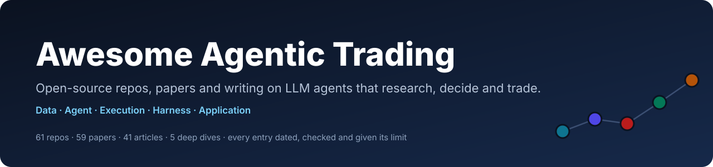

<p align="center"></p>

<p align="center">
  <a href="https://awesome.re"></a>
  <a href="https://github.com/orangejustin/awesome-agentic-trading/actions/workflows/ci.yml"></a>
  <a href="LICENSE"></a>
  <a href="CONTRIBUTING.md"></a>
</p>

<p align="center"><a href="README.md">English</a> · <b>简体中文</b></p>

> 一份经过核验的**开源智能体交易（Agentic Trading）**地图：开源仓库、论文、文章与帖子，按智能体交易系统的五层组织：**数据层 → Agent 层 → 执行层 → Harness 层 → 应用层**。

<!-- gen:headline -->52 个开源仓库 · 58 篇论文 · 17 篇文章与帖子 · 5 个深度拆解<!-- /gen:headline -->。每个仓库条目都写明做什么、许可证、是否仍在维护，以及最关键的限制；每篇论文都标明我们实际读到了什么程度。

> [!WARNING]
> 仅供研究与学习，不构成任何投资建议。部分工具可以下真实订单（标记为 ⚡），请先在模拟账户上使用。被收录不代表项目能盈利或可直接用于生产。

## 目录

- [五层结构](#五层结构)
- [从这里开始](#从这里开始)
- [里程碑](#里程碑)
- [1. 数据层：智能体看到什么](#1-数据层智能体看到什么)
- [2. Agent 层：智能体如何思考](#2-agent-层智能体如何思考)
- [3. 执行层：智能体如何下单](#3-执行层智能体如何下单)
- [4. Harness 层：如何运行、测试并信任它](#4-harness-层如何运行测试并信任它)
- [5. 应用层：用它做出什么](#5-应用层用它做出什么)
- [综述](#综述)
- [证据告诉我们什么](#证据告诉我们什么)
- [指南与深度拆解](#指南与深度拆解)
- [实验工具](#实验工具)
- [相关清单](#相关清单)
- [收录原则](#收录原则)
- [参与贡献](#参与贡献)

## 五层结构

<p align="center"></p>

数据层、Agent 层、执行层构成主流程：看见、思考、行动。Harness 层包裹这三层，决定你如何运行、测试并信任它们；应用层位于最上方。每一层都有独立页面（英文），收录该层全部仓库、论文、文章与帖子，以及常见失败模式和构建建议。[条目如何归层 →](layers/README.md#how-entries-are-placed)

<!-- gen:stack -->
| 层 | 回答的问题 | 仓库 | 论文 | 文章 |
|---|---|---|---|---|
| [1. 数据层](layers/data.md) | 智能体知道什么？什么时候知道的？ | 10 | 5 | 5 |
| [2. Agent 层](layers/agent.md) | 拿到信号之后，结论是什么？理由如何论证？ | 8 | 22 | 0 |
| [3. 执行层](layers/execution.md) | 决策如何安全地变成成交？ | 6 | 1 | 0 |
| [4. Harness 层](layers/harness.md) | 结果是真的吗？如果它不再成立，我们能及时发现吗？ | 17 | 17 | 10 |
| [5. 应用层](layers/application.md) | 它为用户端到端完成什么工作？ | 11 | 8 | 2 |
<!-- /gen:stack -->

## 从这里开始

| 你想要 | 从这里开始 | 所在层 |
|---|---|---|
| 研究一家公司并写报告，且数字由代码计算 | [FinRobot](https://github.com/AI4Finance-Foundation/FinRobot) | 应用层 |
| 研究会辩论个股的多智能体“交易公司” | [TradingAgents](https://github.com/TauricResearch/TradingAgents)、[ContestTrade](https://github.com/FinStep-AI/ContestTrade) | Agent 层 |
| 在模拟基金里试验投资智能体 | [AI Hedge Fund](https://github.com/virattt/ai-hedge-fund) | 应用层 |
| 自动化因子与模型研究 | 基于 [Qlib](https://github.com/microsoft/qlib) 的 [RD-Agent](https://github.com/microsoft/RD-Agent) | 应用层、Harness 层 |
| 给智能体接入行情数据 | [OpenBB](https://github.com/OpenBB-finance/OpenBB)、[Yahoo Finance MCP](https://github.com/Alex2Yang97/yahoo-finance-mcp)、[Massive MCP Server](https://github.com/massive-com/mcp_massive) | 数据层 |
| 让智能体下单（先用模拟盘） | [Alpaca MCP Server](https://github.com/alpacahq/alpaca-mcp-server)、[Polymarket MCP Server](https://github.com/caiovicentino/polymarket-mcp-server) | 执行层 |
| 用成熟引擎回测与实盘 | [LEAN](https://github.com/QuantConnect/Lean)、[NautilusTrader](https://github.com/nautechsystems/nautilus_trader) | 执行层 |
| 评测或压力测试交易智能体 | [DeepFund](https://github.com/HKUSTDial/DeepFund)、[Live Trade Bench](https://github.com/ulab-uiuc/live-trade-bench)、[TradeTrap](https://github.com/Yanlewen/TradeTrap) | Harness 层 |
| 看真实的前向记录，无论好坏 | [Kalshi AI Trading Bot](https://github.com/ryanfrigo/kalshi-ai-trading-bot)（公开了自己“未测出优势”的结论）、[LLM Trading Lab](https://github.com/LuckyOne7777/LLM-Trading-Lab) | Harness 层 |
| 判断别人给你看的回测是否可信 | [如何读回测](docs/06-reading-a-backtest.md)（英文）与[评测工具](#实验工具) | Harness 层 |

## 里程碑

关键节点，每条都写明为什么重要。完整目录按层列在下方。

<!-- gen:milestones -->
| 时间 | 里程碑 | 为什么重要 |
|---|---|---|
<!-- /gen:milestones -->

**图例：** 🟢 活跃（核验时最近 90 天内有提交）· 🟡 放缓（一年内）· ⚪ 停更 · ⚡ 可下真实订单 · 📝 模拟交易 · 🧰 用于此环节的通用工具 · 🔬 我们的深度拆解。同一类别内按核验时的 GitHub Star 数排序：这是热度信号，不是质量评分。

<!-- gen:directory -->
## 1. 数据层：智能体看到什么

> 智能体知道什么？什么时候知道的？

**10 个仓库 · 5 篇论文 · 5 篇文章** · [完整分层页（英文）→](layers/data.md)

### 行情与基本面数据

- [OpenBB](https://github.com/OpenBB-finance/OpenBB) — 面向Python与AI智能体的开放金融数据集成平台。 ⚠️ 只管取数，时点正确性需自己保证。 🟢 `Apache-2.0`
- [TradingView-API](https://github.com/Mathieu2301/TradingView-API) — 非官方的 TradingView TypeScript 客户端，可取 K 线、指标、选股器与回放数据，附防前视的回测模块。 ⚠️ 非官方，依赖未公开接口，存在条款风险；根目录无 LICENSE 文件（package.json 声明 ISC） 🟢 `未找到许可证`

### 财报、新闻与文本

- [Agent-Reach](https://github.com/Panniantong/Agent-Reach) — 让编程智能体读取 X、Reddit、小红书、雪球、视频字幕等平台的命令行工具。 ⚠️ 复用浏览器登录 Cookie（建议用小号）；有平台条款风险；健康检查通过不等于取数正确。 🟢 `MIT` 🧰
- [OpenCLI](https://github.com/jackwener/OpenCLI) — 把网站变成 JSON 命令的浏览器自动化命令行，通过已登录的 Chrome 为智能体取数。 ⚠️ 以已登录账户的权限运行；网站改版会导致适配器失效；应只放行只读命令。 🟢 `Apache-2.0` 🧰
- [Trafilatura](https://github.com/adbar/trafilatura) — 从新闻、公告网页中抽取正文与元数据（标题、作者、日期） ⚠️ 只负责抽取，不支持登录与 JavaScript 渲染；仍需遵守网站条款。 🟢 `Apache-2.0` 🧰

### 面向智能体的数据服务（MCP）

- [Financial Datasets MCP Server](https://github.com/financial-datasets/mcp-server) — 提供 Financial Datasets API 财务、价格与新闻的 MCP 服务器。 ⚠️ 需要 Financial Datasets API 密钥；最后提交于 2025-06-05。 ⚪ `MIT`
- [Massive MCP Server](https://github.com/massive-com/mcp_massive) — Massive（原 Polygon.io）行情 API 的官方 MCP 服务器。 ⚠️ 作者标注为实验性，且需要 API 密钥。 🟢 `MIT`
- [Yahoo Finance MCP](https://github.com/Alex2Yang97/yahoo-finance-mcp) — 为LLM客户端提供Yahoo Finance数据的MCP服务器。 ⚠️ 基于yfinance当前数据而非时点存档，不适合回测。 🟢 `MIT`
- [TradingView MCP (Desktop)](https://github.com/tradesdontlie/tradingview-mcp) — 让智能体读取并操作本地 TradingView 桌面版的 MCP 服务：图表、指标、Pine 脚本、告警。 ⚠️ 经未公开接口操控桌面应用（有条款风险）；先只开只读工具；活跃分支见 iliaal/tradingview-mcp。 🟢 `MIT`

### 数据校验与证据记录

- [pandera](https://github.com/unionai-oss/pandera) — 数据框的模式与统计校验：缺 K 线、类型错误、价格越界时立即失败。 ⚠️ 只检查结构与取值，无法单独发现前视偏差、幸存者偏差或数据过期。 🟢 `MIT` 🧰

### 必读

- [Can ChatGPT Forecast Stock Price Movements? Return Predictability and Large Language Models](https://arxiv.org/abs/2304.07619) — Alejandro Lopez-Lira et al., 2023. 用 ChatGPT/GPT-4 给新闻标题打分，并用模型截止日期之后的标题检验其对次日收益的预测力；预测力随 LLM 普及而减弱。
- [FNSPID: A Comprehensive Financial News Dataset in Time Series](https://arxiv.org/abs/2402.06698) — Zihan Dong et al., 2024. FNSPID：与股价按时间对齐的金融新闻数据集，用于文本加数值的预测研究。
- 📘 [TradingView MCP Server FAQ](https://www.tradingview.com/support/solutions/43000795700-mcp-server-faq/) — TradingView, 2026-10. 接入前必读：即使订阅实时行情，MCP 数据仍有延迟；测试版不支持 Pine 与指标告警；无人值守或服务器托管不在使用范围内。适合交互式研究，不适合作为无人值守的数据源。

## 2. Agent 层：智能体如何思考

> 拿到信号之后，结论是什么？理由如何论证？

**8 个仓库 · 22 篇论文 · 0 篇文章** · [完整分层页（英文）→](layers/agent.md)

### 金融大模型与推理模型

- [FinGPT](https://github.com/AI4Finance-Foundation/FinGPT) — 开源金融LLM项目，含数据管道与LoRA微调方案。 ⚠️ 模型与数据项目，未核对交易表现。 🟢 `MIT`
- [Qwen DianJin](https://github.com/aliyun/qwen-dianjin) — 阿里云金融推理模型、数据与基准合集。 ⚠️ 属研究合集而非交易系统，各子项目文档与许可证独立。 🟢 `MIT (sub-projects under Apache-2.0 in LICENSES/)`
- [Kronos](https://github.com/shiyu-coder/Kronos) — 面向 K 线（OHLCV）序列的基础模型，已发布权重与微调脚本。 ⚠️ 研究级预测；使用前须在样本外与简单基线、随机游走对比。 🟡 `MIT`

### 多智能体决策架构

- [TradingAgents](https://github.com/TauricResearch/TradingAgents) — 基于 LangGraph 的多智能体交易公司，输出五级评级。 ⚠️ 仅评估决策质量，无组合模拟、Sharpe 代码及论文评测框架。 🟢 `Apache-2.0` [🔬 拆解](docs/teardowns/tradingagents.md)
- [QuantAgent / QuantHarness](https://github.com/Y-Research-SBU/QuantAgent) — LangGraph多智能体短线技术分析系统。 ⚠️ 论文回测未重跑，短周期结果需长记录验证。 🟢 `MIT`
- [ContestTrade](https://github.com/FinStep-AI/ContestTrade) — 多智能体竞赛框架，按预测Sharpe分配权重。 ⚠️ 仓库无回测代码，无法复现论文Table 1结果。 🟡 `Apache-2.0` [🔬 拆解](docs/teardowns/contesttrade.md)

### 单智能体、记忆与反思

- [FinMem](https://github.com/pipiku915/FinMem-LLM-StockTrading) — 带风险画像与三层衰减记忆的单一交易智能体。 ⚠️ 仓库不含市场数据，仅有占位文件和伪造样例压缩包。 ⚪ `MIT` [🔬 拆解](docs/teardowns/finmem.md)

### 强化学习与学习型策略

- [FinRL](https://github.com/AI4Finance-Foundation/FinRL) — 面向股票交易环境的深度强化学习库与教程。 ⚠️ 偏教学的 RL 环境，未核对其头条结果。 🟢 `MIT`

### 必读

- [FinMem: A Performance-Enhanced LLM Trading Agent with Layered Memory and Character Design](https://arxiv.org/abs/2311.13743) — Yangyang Yu et al., 2023. 单一交易智能体：新闻、10-Q、10-K 三层衰减记忆加风险画像提示词；在 5 只股票上测试约 6 个月。
- [FinCon: A Synthesized LLM Multi-Agent System with Conceptual Verbal Reinforcement for Enhanced Financial Decision Making](https://arxiv.org/abs/2407.06567) — Yangyang Yu et al., 2024. 经理—分析师层级结构，加一个风控组件，把每轮自我批评作为“概念化语言强化”反馈回去。
- [TradingAgents: Multi-Agents LLM Financial Trading Framework](https://arxiv.org/abs/2412.20138) — Yijia Xiao et al., 2024. 按角色组织的 LLM“交易公司”：分析师、多空辩论、交易员、风险辩论、组合经理；回测仅覆盖 2024 年 1–3 月的少数美股科技股。

## 3. 执行层：智能体如何下单

> 决策如何安全地变成成交？

**6 个仓库 · 1 篇论文 · 0 篇文章** · [完整分层页（英文）→](layers/execution.md)

### 券商与交易场所工具

- [Alpaca MCP Server](https://github.com/alpacahq/alpaca-mcp-server) — 让LLM客户端查询行情并通过Alpaca下单的MCP服务器。 ⚠️ 赋予智能体下单权限，应先在模拟账户上运行。 🟢 `MIT` ⚡
- [Polymarket MCP Server](https://github.com/caiovicentino/polymarket-mcp-server) — 提供45个Polymarket交易与监控工具的MCP服务器。 ⚠️ LLM客户端可动用真实资金下单，应先用模拟账户测试。 🟢 `MIT` ⚡
- [fintool](https://github.com/second-state/fintool) — 为智能体提供分交易所交易与行情的 Rust CLI 套件。 ⚠️ 可在真实交易所下单，建议先用小仓位或测试网。 🟡 `MIT` ⚡

### 交易引擎（回测与实盘同一套代码）

- [NautilusTrader](https://github.com/nautechsystems/nautilus_trader) — 同一策略代码可用于回测与实盘的事件驱动引擎。 ⚠️ 通用引擎，非 LLM 专用，智能体接入需自建。 🟢 `LGPL-3.0` ⚡
- [LEAN](https://github.com/QuantConnect/Lean) — 用于研究、回测与实盘交易的事件驱动交易引擎。 ⚠️ 通用引擎，非 LLM 专用，智能体接入需自建。 🟢 `Apache-2.0` ⚡

### 从目标权重到订单

- [FinRL-X (FinRL-Trading)](https://github.com/AI4Finance-Foundation/FinRL-Trading) — 以目标权重为核心的回测与券商下单管线。 ⚠️ RL 配置仅略胜等权，无择时时均不及 QQQ。 🟢 `Apache-2.0` ⚡ [🔬 拆解](docs/teardowns/finrl-x.md)

### 必读

- [FinRL-X: An AI-Native Modular Infrastructure for Quantitative Trading](https://arxiv.org/abs/2603.21330) — Hongyang Yang et al., 2026. FinRL-X：以目标权重为核心的流水线（选股、配置、择时、风控叠加），回测与券商执行共用一套代码；含 2018–2025 回测和 4.5 个月模拟盘。

## 4. Harness 层：如何运行、测试并信任它

> 结果是真的吗？如果它不再成立，我们能及时发现吗？

**17 个仓库 · 17 篇论文 · 10 篇文章** · [完整分层页（英文）→](layers/harness.md)

### 研究与回测环境

- [Qlib](https://github.com/microsoft/qlib) — 含数据层、ML模型库与回测工具的量化研究平台。 ⚠️ 通用量化平台，LLM 智能体部分需自建。 🟢 `MIT`
- [Agentic Trading Lab](https://github.com/Open-Finance-Lab/AgenticTrading) — 构建、回测与模拟交易LLM交易智能体的研究平台。 ⚠️ 采用不常见的OpenMDW-1.0许可证，复用前需阅读。 🟢 `OpenMDW-1.0` 📝

### 模拟器与纸面交易环境

- [StockAgent](https://github.com/MingyuJ666/Stockagent) — LLM投资者在模拟股票交易所中交易。 ⚠️ 仓库中没有LICENSE文件，使用条款不明确。 🟡 `未找到许可证`
- [polymarket-paper-trader](https://github.com/agent-next/polymarket-paper-trader) — 基于 Polymarket 实时订单簿的智能体模拟交易环境。 ⚠️ 仅限预测市场而非股票，成交逼真度为作者自述。 🟢 `MIT` 📝

### 基准、竞技场与前向实盘记录

- [AI-Trader](https://github.com/HKUDS/AI-Trader) — 外部AI智能体注册交易的平台与实时排行榜。 ⚠️ 仓库根目录无LICENSE文件，仅README徽章标注MIT。 🟡 `MIT (README badge)`
- [LLM Trading Lab](https://github.com/LuckyOne7777/LLM-Trading-Lab) — ChatGPT管理真实资金微盘股组合的六个月实盘记录。 ⚠️ 仅六个月单次运行且由作者自评，不足以证明能力。 🟡 `未找到许可证`
- [PIXIU / FinBen](https://github.com/The-FinAI/PIXIU) — 开源金融LLM FinMA及FinBen评测套件。 ⚠️ 任务高分难以反映实际交易表现。 🟢 `MIT`
- [DeepFund](https://github.com/HKUSTDial/DeepFund) — 在截止日后数据上评测LLM基金经理的实时竞技场。 ⚠️ 竞技场结果取决于较短的实盘窗口。 🟡 `MIT`
- [Live Trade Bench](https://github.com/ulab-uiuc/live-trade-bench) — 在美股与Polymarket上实盘运行并监控LLM交易智能体。 ⚠️ 采用非商业许可，复用前需核查条款。 🟡 `PolyForm Noncommercial 1.0.0`

### 稳健性与偏差控制

- [TradeTrap](https://github.com/Yanlewen/TradeTrap) — 面向LLM交易智能体的故障注入测试工具。 ⚠️ 测的是鲁棒性，不是盈利能力。 🟡 `Apache-2.0`

### Agent Harness：循环、评测、追踪与状态

- [Harbor](https://github.com/harbor-framework/harbor) — 容器化的智能体评测框架：任务、写入奖励的独立验证器、基准与 RL 轨迹。 ⚠️ 行情数据与模拟器需打包成容器任务；云沙箱需付费。 🟢 `Apache-2.0` 🧰
- [Harness²](https://github.com/google-research/harness2) — 在不改模型权重的前提下按任务调优智能体 Harness（提示词、工具、记忆、技能）的研究框架。 ⚠️ 研究代码，评测基准与交易无关；须保留改进循环看不到的留出集。 🟢 `Apache-2.0` 🧰
- [Langfuse](https://github.com/langfuse/langfuse) — 可自托管的 LLM 应用与智能体追踪、提示词管理与评测平台。 ⚠️ ee/ 目录采用单独许可证；自托管需部署多个服务。 🟢 `MIT (ee/ directories under a separate license)` 🧰
- [learn-claude-code](https://github.com/shareAI-lab/learn-claude-code) — 用 Python 从零逐步搭建小型编程智能体 Harness 的教程。 ⚠️ 教学代码，非生产级；与 Anthropic 无关。 🟢 `MIT` 🧰
- [Pi (with Pi Durable)](https://github.com/earendil-works/pi) — 极简、可改造的 TypeScript 智能体 Harness；Pi Durable 为每一步做检查点，崩溃后可续跑。 ⚠️ Durable 包仍属实验性；续跑某一步不等于对账真实副作用（如订单） 🟢 `MIT` 🧰
- [promptfoo](https://github.com/promptfoo/promptfoo) — 声明式的提示词与智能体评测和红队测试，可在 CI 中运行。 ⚠️ 通用 LLM 评测：交易专用评分器、行情样例与盈亏指标需自行编写。 🟢 `MIT` 🧰
- [Single Agent Loop Kit](https://github.com/anthropics/single-agent-loop-kit) — 度量多智能体系统、并在评测下把子智能体合并进单循环的参考工具包。 ⚠️ 参考实现，不再维护；示例是客服场景而非交易。 🟢 `Apache-2.0` 🧰

### 必读

- [Can LLM-based Financial Investing Strategies Outperform the Market in Long Run?](https://arxiv.org/abs/2505.07078) — Weixian Waylon Li et al., 2025. FINSABER：控制幸存者偏差、前视偏差和数据窥探的回测框架，覆盖二十年、100 多个标的；早先报告的 LLM 优势明显缩小。
- [Time Travel is Cheating: Going Live with DeepFund for Real-Time Fund Investment Benchmarking](https://arxiv.org/abs/2505.11065) — Changlun Li et al., 2025. DeepFund：只使用各模型知识截止日之后发布的数据的实时基金竞技场；报告称即使强模型（DeepSeek-V3、Claude-3.7-Sonnet）在实时运行中也亏损。
- [Detecting Lookahead Bias in LLM Forecasts](https://arxiv.org/abs/2512.23847) — Zhenyu Gao et al., 2025. 前视倾向（LAP）：只给日期的回忆式提问，估计 LLM 对结果的记忆程度，用于检测预测是否被污染。
- 📝 [Effective harnesses for long-running agents](https://www.anthropic.com/research/effective-harnesses-for-long-running-agents) — Justin Young (Anthropic), 2025-11. 先由初始化智能体搭好脚手架，再由工作智能体每次只完成一个单元、端到端测试，并为下一次会话留下 git 历史和进度记录。同样适用于持续多天的投研与策略开发。
- 📝 [Building agents: When to fold subagents into your main agent loop](https://claude.com/resources/articles/building-agents-when-to-fold-subagents-into-your-main-agent-loop) — Diane Sarkis (Anthropic), 2026-10. 许多智能体用“单循环 + 按需加载技能”比“协调者 + 多个子智能体”效果更好；只在需要隔离上下文、并行独立任务或指令冲突时保留子智能体，并在评测下逐步迁移。直接适用于分析师/风控/交易员式的多智能体团队。

## 5. 应用层：用它做出什么

> 它为用户端到端完成什么工作？

**11 个仓库 · 8 篇论文 · 2 篇文章** · [完整分层页（英文）→](layers/application.md)

### 投研与报告

- [FinRobot](https://github.com/AI4Finance-Foundation/FinRobot) — 代码算数、LLM写叙述的股票研究智能体平台。 ⚠️ 属于股票研究工作站而非交易系统，无可检验的交易业绩声明。 🟢 `Apache-2.0` [🔬 拆解](docs/teardowns/finrobot.md)
- [OpenTerminalUI](https://github.com/Hitheshkaranth/OpenTerminalUI) — 可自托管的投研终端，AI 分析师会引用公告并标注每个数字的来源。 ⚠️ 单人维护的小项目；免费数据可能延迟或为合成数据（有标注）；仅支持模拟操作。 🟢 `MIT` 📝

### AI 基金与组合管理

- [AI Hedge Fund](https://github.com/virattt/ai-hedge-fund) — LLM投资者智能体执行基金策略并回测历史。 ⚠️ 作者声明仅供教育用途，不下单交易，结果未经复现。 🟢 `MIT`
- [Vibe-Trading](https://github.com/HKUDS/Vibe-Trading) — 个人交易智能体全栈（CLI、MCP、Web）：投研、带运行卡与验证的回测、模拟账户，以及会对账的实盘执行器。 ⚠️ 实盘券商连接有真实执行风险；未核对表现声明；注意冒名的代币与账号。 🟢 `MIT` ⚡
- [TradingAgents-CN](https://github.com/hsliuping/TradingAgents-CN) — 面向A股的TradingAgents社区衍生框架。 ⚠️ 混合许可：应用层仅源码可见，并非开源。 🟢 `Apache-2.0 core + proprietary app layer` 📝

### 因子工厂（量化研究自动化）

- [RD-Agent](https://github.com/microsoft/RD-Agent) — 提出、实现并评估量化因子与模型的智能体循环。 ⚠️ 未核对头条结果，因子收益需留出样本检验。 🟢 `MIT`
- [QuantaAlpha](https://github.com/QuantaAlpha/QuantaAlpha) — LLM驱动的进化式因子挖掘框架。 ⚠️ 仓库无LICENSE文件，MIT仅见于README徽章。 🟡 `MIT (README badge)`
- [AlphaGen](https://github.com/RL-MLDM/alphagen) — 基于Qlib的强化学习公式化因子生成框架。 ⚠️ 仓库无LICENSE文件；核心为强化学习，LLM模块为后加。 🟡 `未找到许可证`

### 预测市场

- [Kalshi AI Trading Bot](https://github.com/ryanfrigo/kalshi-ai-trading-bot) — 带边际审计、MCP server 与代理工具的 Kalshi 交易工具包。 ⚠️ 其自身 55 笔前向交易的结论为无可测边际，账户含人工交易。 🟢 `MIT` ⚡
- [Oracle3](https://github.com/YichengYang-Ethan/oracle3) — Kalshi与Polymarket预测市场代理工具包。 ⚠️ 只有声明，没有公开回测或记录。 🟢 `Apache-2.0` ⚡
- [Kalshi Trading Bot CLI](https://github.com/OctagonAI/kalshi-trading-bot-cli) — 估算Kalshi市场概率并以分数Kelly定仓的CLI。 ⚠️ 未公布业绩记录；概率估算可能依赖供应商研究API。 🟢 `MIT`

### 必读

- [FinRobot: An Open-Source AI Agent Platform for Financial Applications using Large Language Models](https://arxiv.org/abs/2405.14767) — Hongyang Yang et al., 2024. FinRobot 白皮书：分层的金融 LLM 智能体平台（智能调度器、金融思维链）；第 5 节展示两个应用样例，没有收益指标。
- [R&D-Agent-Quant: A Multi-Agent Framework for Data-Centric Factors and Model Joint Optimization](https://arxiv.org/abs/2505.15155) — Yuante Li et al., 2025. RD-Agent(Q)：多智能体循环，自动提出、实现并评估量化研究中的因子与模型。
<!-- /gen:directory -->

## 综述

<!-- gen:surveys -->
- [Large Language Models in Finance: A Survey](https://arxiv.org/abs/2311.10723) — Yinheng Li et al., 2023. 实用综述：金融场景中 LLM 的零样本使用、微调与定制训练。
- [A Survey of Large Language Models for Financial Applications: Progress, Prospects and Challenges](https://arxiv.org/abs/2406.11903) — Yuqi Nie et al., 2024. 金融领域 LLM 应用综述，含前景与挑战。
- [From Deep Learning to LLMs: A survey of AI in Quantitative Investment](https://arxiv.org/abs/2503.21422) — Bokai Cao et al., 2025. 量化投资中的 AI 综述：从手工特征、深度学习到 LLM 智能体，以 alpha 策略贯穿。
- [The New Quant: A Survey of Large Language Models in Financial Prediction and Trading](https://arxiv.org/abs/2510.05533) — Weilong Fu, 2025. 以任务为中心的 LLM 收益预测与交易分类体系，基于 50 余篇一手研究。
- [Agentic Trading: When LLM Agents Meet Financial Markets](https://arxiv.org/abs/2605.19337) — Yihan Xia et al., 2026. 按架构、能力与适应方式梳理智能体交易的综述。
<!-- /gen:surveys -->

## 证据告诉我们什么

- **没有任何头条结果被独立复现。** 我们读过的三个公布交易结果表的智能体系统（TradingAgents、FinMem、ContestTrade），仓库里都缺少重新生成结果所需的代码或数据（[论文与代码核对](docs/05-claim-audit.md)）。
- **头条 Sharpe 只来自几个月的数据。** 三个月数据下 Sharpe 的误差约为 ±2；真实 Sharpe 为 1 的策略需要接近三年才能与零区分开（[如何读回测](docs/06-reading-a-backtest.md)）。
- **架构对比很少控制成本。** TradingAgents 每个决策调用模型 11 次以上，却只和规则基线比较，而不是和同一模型的单次调用比较（[公平评测](docs/04-fair-evaluation.md)）。
- **热门清单几乎不重叠。** 四个清单共链接 584 个仓库，没有一个同时出现在四个清单里（[清单对比](docs/03-lists-compared.md)）。

## 指南与深度拆解

以下页面以英文维护。

| 页面 | 一句话 |
|---|---|
| [第一性原理](docs/00-first-principles.md) | 任何交易系统（无论是否用 LLM）都必须满足的七条。 |
| [五层结构](layers/README.md) | 五层、每层回答的问题，以及条目如何归层。 |
| [证据阶梯](docs/02-evidence-ladder.md) | L0 到 L4：他人能把一项声明检查到什么程度。 |
| [清单对比](docs/03-lists-compared.md) | 四个热门清单覆盖了什么、遗漏了什么。 |
| [公平评测](docs/04-fair-evaluation.md) | 同数据、同模型、同预算，并设单次调用基线。 |
| [论文与代码核对](docs/05-claim-audit.md) | 论文与仓库对不上的地方，附版本号。 |
| [如何读回测](docs/06-reading-a-backtest.md) | 误差范围、记录长度、选择偏差。 |
| [方法论](docs/07-methodology.md) | 目录如何构建，哪些由程序检查。 |
| 深度拆解 | [TradingAgents](docs/teardowns/tradingagents.md) · [FinRobot](docs/teardowns/finrobot.md) · [FinMem](docs/teardowns/finmem.md) · [ContestTrade](docs/teardowns/contesttrade.md) · [FinRL-X](docs/teardowns/finrl-x.md)，均读到指定提交的代码层面。 |
| [完整目录](docs/catalog/projects.md) · [全部论文](docs/catalog/papers.md) | 含 Star、证据等级与更长说明的总表。 |
| [方法卡片](docs/cards/index.md) | 机器抽取的论文摘要；每个字段都有程序在原文中找到的引文支撑。 |

## 实验工具

自己动手检验声明。需要 Python 3.11 及以上；除方法卡片抽取外只用标准库。

```bash
python -m tools.evalkit se --sr 5.6 --years 0.25            # 报告的 Sharpe 的标准误
python -m tools.evalkit min-record --sr 1.0                 # Sharpe 与零区分开需要几年记录
python -m tools.evalkit diff-years --delta 0.5 --sr-low 0.5 --rho 0.9   # 区分两个智能体需要几年
python -m tools.evalkit card-template                       # 一次评测应公布的报告卡
python tools/verify.py all                                  # 重新核对每个 arXiv 编号与仓库（需联网）
```

- [`tools/evalkit`](tools/evalkit/)：Sharpe 误差范围、最短记录长度、Deflated Sharpe、配对 bootstrap、预算账本。
- [`tools/extract`](tools/extract/)：生成方法卡片，每篇论文一次 Claude API 调用；引文不在原文中的字段会被程序丢弃。

## 相关清单

本清单的来源与对照对象（[对比](docs/03-lists-compared.md)）。不含智能体组件的通用量化工具，请看 [awesome-quant](https://github.com/wilsonfreitas/awesome-quant)。

<!-- gen:related -->
- [LLMQuant awesome-trading-agents](https://github.com/LLMQuant/awesome-trading-agents) — 智能体交易仓库与工具的链接清单（按我们的链接计数，除自身外有 116 个 GitHub 仓库、3 个 arXiv 链接）。
- [Awesome-LLM-Quantitative-Trading-Papers](https://github.com/Tom-roujiang/Awesome-LLM-Quantitative-Trading-Papers) — LLM 量化交易论文清单（按我们的链接计数，37 个 arXiv 链接、12 个 GitHub 仓库）。
- [awesome-open-source-trading](https://github.com/WallStreetPete/awesome-open-source-trading) — 规模最大的清单：按我们的链接计数有 470 个 GitHub 仓库、94 个 arXiv 链接（含其 JSON 数据文件）。
- [awesome-llm-trading-agents](https://github.com/bettyguo/awesome-llm-trading-agents) — 仓库与论文混合清单，每个条目一个文件（按我们的链接计数，37 个 GitHub 仓库、33 个 arXiv 链接）。
<!-- /gen:related -->

## 收录原则

- **边界清楚。** 收录：由 LLM 或智能体做研究、决策或交易的开源工作，以及这类系统所依赖的数据、执行与 Harness 基础设施。不收录：没有智能体接口的通用量化库（见 [awesome-quant](https://github.com/wilsonfreitas/awesome-quant)）、闭源产品、卖信号。
- **准入门槛。** 仓库需要已发布代码、可读的 README、根目录许可证文件（或明确标注缺失），以及独特用途。只有公告、尚无代码的仓库放在分层页的观察名单里。
- **每个条目都写限制。** 写出最可能改变你选择的那一点：环境要求、仅模拟、下单权限、缺数据、不常见的许可证。
- **收集不等于读过。** 论文按阅读深度标记（📖 全文精读、🗂️ 方法卡片、🔖 仅摘要）；仓库同样标记（🔬 深度拆解，或 README 与代码浏览）。
- **注明日期并定期复核。** 许可证与最近提交来自核验当日的浅克隆；每周任务会重新核对所有论文与仓库。Star 仅作参考，从不作为收录标准。
- **数据优先。** 以上内容全部由 [`tools/build.py`](tools/build.py) 从 [`catalog/`](catalog/) 生成，中英文来自同一份条目；页面过期时 CI 会失败。详见[方法论](docs/07-methodology.md)。

## 参与贡献

欢迎推荐与纠错。最快的方式是提一个 [issue](https://github.com/orangejustin/awesome-agentic-trading/issues/new/choose)，附链接和一句话；条目模板与准入规则见 [CONTRIBUTING.md](CONTRIBUTING.md)。中文或英文提交均可。

## 许可证

本仓库的文字与工具采用 [MIT](LICENSE) 许可证。所链接的论文与仓库保留各自的许可证。
