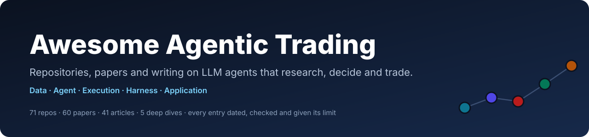
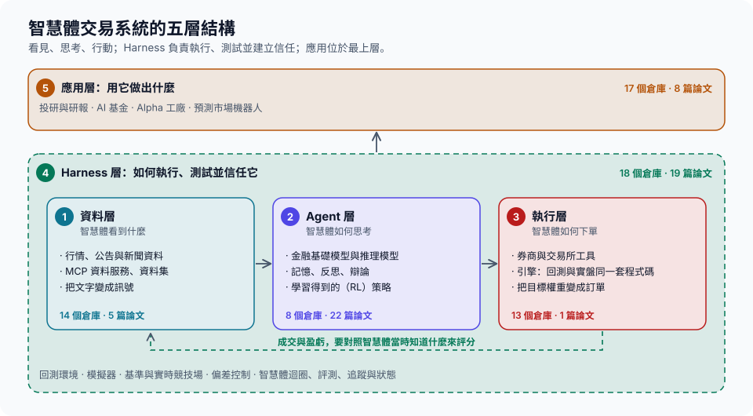

<!-- generated by tools/build.py from README.zh-CN.md; do not edit by hand -->
<p align="center"></p>

<h1 align="center">Awesome Agentic Trading</h1>

<p align="center"><a href="README.md">English</a> | <a href="README.zh-CN.md">简体中文</a> | <b>繁體中文</b></p>

<p align="center">
  <a href="https://awesome.re"></a>
  <a href="https://github.com/orangejustin/awesome-agentic-trading/actions/workflows/ci.yml"></a>
  <a href="https://github.com/orangejustin/awesome-agentic-trading/actions/workflows/verify.yml"></a>
  <a href="LICENSE"></a>
  <a href="CONTRIBUTING.md"></a>
</p>

> 一份逐條核對過來源的指南，幫助你構建和評測**由 LLM 驅動的交易系統**：公開倉庫、論文、文章與貼文，按系統的五層組織：**資料層 → Agent 層 → 執行層 → Harness 層 → 應用層**。

<!-- gen:headline -->70 個倉庫（57 個開源 · 5 個混合或受限授權 · 8 個授權待確認）· 60 篇論文 · 41 篇文章與貼文 · 5 個深度拆解<!-- /gen:headline -->。每個倉庫條目都寫明做什麼、能否下單、採用什麼授權條款，以及最關鍵的限制；每篇論文都標明我們實際讀到了什麼程度。

**“核驗”指什麼。** 每個倉庫都在一個確定的提交上讀過：README、授權條款檔案，以及決定它能否下單的那幾行。這是*來源核查*：它說明倉庫裡有什麼，不說明策略有效，也不說明任何收益屬實。安裝專案、端到端跑通是更強的結論，只有頁面明確寫出時才成立（見[元件矩陣](docs/components.md)，英文）。程式每週重新檢查全部連結（[最新報告](https://github.com/orangejustin/awesome-agentic-trading/actions/workflows/verify.yml)）；條目上的核驗日期是人最後一次讀它的日期，程式不會改動。

**三條入口：**

- 🔎 **找工具：** 在[從這裡開始](#從這裡開始)按你要做的事來選，在[專案目錄](#專案目錄)瀏覽全部倉庫及各自的限制，或用[元件矩陣](docs/components.md)（英文）挑選能配合使用的元件。
- 🧭 **理解這個領域：** [五層結構](#五層結構)解釋五層各自回答的問題，[近期里程碑](#近期里程碑)與[完整時間線](docs/milestones.zh-TW.md)說明它如何走到今天，[第一性原理](docs/00-first-principles.md)（英文）與[深度拆解](#指南與深度拆解)可以繼續深入。
- 🧪 **核驗一項宣告：** [證據告訴我們什麼](#證據告訴我們什麼)列出四條發現並附來源，[如何讀回測](docs/06-reading-a-backtest.md)（英文）與[評測工具](#實驗工具)讓你自己檢驗一個數字，[論文與程式碼核對](docs/05-claim-audit.md)（英文）記錄了論文與程式碼對不上的地方。

> [!WARNING]
> 僅供研究與學習，不構成任何投資建議。部分工具可以下真實訂單（標記為 ⚡，連結到支援該結論的原文行）；請先用唯讀模式，或在有模擬盤時先用模擬帳戶。被收錄不代表專案能盈利或可直接用於生產。


## 目錄

- [從這裡開始](#從這裡開始)
- [五層結構](#五層結構)
- [證據告訴我們什麼](#證據告訴我們什麼)
- [近期里程碑](#近期里程碑)
- [專案目錄](#專案目錄)：[資料層](#1-資料層智慧體看到什麼) · [Agent 層](#2-agent-層智慧體如何思考) · [執行層](#3-執行層智慧體如何下單) · [Harness 層](#4-harness-層如何執行測試並信任它) · [應用層](#5-應用層用它做出什麼)
- [綜述](#綜述)
- [指南與深度拆解](#指南與深度拆解)
- [實驗工具](#實驗工具)
- [相關清單](#相關清單)
- [收錄原則](#收錄原則)
- [參與貢獻](#參與貢獻)

## 從這裡開始

| 你想要 | 從這裡開始 | 所在層 |
|---|---|---|
| 研究一家公司並寫報告，且數字由程式碼計算 | [FinRobot](https://github.com/AI4Finance-Foundation/FinRobot) | 應用層 |
| 研究會辯論個股的多智慧體“交易公司” | [TradingAgents](https://github.com/TauricResearch/TradingAgents)、[ContestTrade](https://github.com/FinStep-AI/ContestTrade) | Agent 層 |
| 在模擬基金裡試驗投資智慧體 | [AI Hedge Fund](https://github.com/virattt/ai-hedge-fund) | 應用層 |
| 自動化因子與模型研究 | 基於 [Qlib](https://github.com/microsoft/qlib) 的 [RD-Agent](https://github.com/microsoft/RD-Agent) | 應用層、Harness 層 |
| 給智慧體接入行情資料 | [OpenBB](https://github.com/openbq-org/OpenBB)、[Yahoo Finance MCP](https://github.com/Alex2Yang97/yahoo-finance-mcp)、[Massive MCP Server](https://github.com/massive-com/mcp_massive) | 資料層 |
| 讓智慧體下單，先確保安全 | [Alpaca MCP Server](https://github.com/alpacahq/alpaca-mcp-server)（預設模擬盤）、[tastytrade MCP](https://github.com/tastytrade/tastytrade-mcp)（唯讀或沙箱模式）、[CCXT](https://github.com/ccxt/ccxt)（ccxt-mcp：交易授權權預設關閉，需手動開啟） | 執行層 |
| 為自己的系統挑選能配合的元件 | [元件矩陣](docs/components.md)（英文）：語言、執行環境、介面、輸入輸出、金鑰與費用、下單授權權 | 全部 |
| 用成熟引擎回測與實盤 | [LEAN](https://github.com/QuantConnect/Lean)、[NautilusTrader](https://github.com/nautechsystems/nautilus_trader) | 執行層 |
| 評測或壓力測試交易智慧體 | [DeepFund](https://github.com/HKUSTDial/DeepFund)、[Live Trade Bench](https://github.com/ulab-uiuc/live-trade-bench)、[TradeTrap](https://github.com/Yanlewen/TradeTrap) | Harness 層 |
| 看真實的前向記錄，無論好壞 | [Kalshi AI Trading Bot](https://github.com/ryanfrigo/kalshi-ai-trading-bot)（公開了自己“未測出優勢”的結論）、[LLM Trading Lab](https://github.com/LuckyOne7777/LLM-Trading-Lab) | Harness 層 |
| 判斷別人給你看的回測是否可信 | [如何讀回測](docs/06-reading-a-backtest.md)（英文）與[評測工具](#實驗工具) | Harness 層 |

## 五層結構

<p align="center"></p>

資料層、Agent 層、執行層構成主流程：看見、思考、行動。Harness 層包裹這三層，決定你如何執行、測試並信任它們；應用層位於最上方。每一層都有獨立頁面（英文），收錄該層全部倉庫、論文、文章與貼文、每個標記背後的證據，以及常見失敗模式和構建建議。[條目如何歸層 →](layers/README.md#how-entries-are-placed)

<!-- gen:stack -->
| 層 | 回答的問題 | 倉庫 | 論文 | 文章 |
|---|---|---|---|---|
| [1. 資料層](layers/data.md) | 智慧體知道什麼？什麼時候知道的？ | 14 | 5 | 6 |
| [2. Agent 層](layers/agent.md) | 拿到訊號之後，結論是什麼？理由如何論證？ | 8 | 22 | 3 |
| [3. 執行層](layers/execution.md) | 決策如何安全地變成成交？ | 13 | 1 | 7 |
| [4. Harness 層](layers/harness.md) | 結果是真的嗎？如果它不再成立，我們能及時發現嗎？ | 18 | 19 | 15 |
| [5. 應用層](layers/application.md) | 它為使用者端到端完成什麼工作？ | 17 | 8 | 10 |
<!-- /gen:stack -->

## 證據告訴我們什麼

- **我們沒能重新生成任何一個頭條交易結果。** 在我們檢查的提交上，讀過的三個公佈交易結果表的智慧體系統（TradingAgents、FinMem、ContestTrade）都沒有提供復現該表所需的完整程式碼和資料。這說的是這些倉庫在這些提交上的情況，不代表沒有人嘗試過：我們所知的唯一一次獨立重跑（FINSABER 重跑 FinMem）得到的收益低得多（[論文與程式碼核對](docs/05-claim-audit.md)）。
- **頭條 Sharpe 只來自幾個月的資料。** 三個月資料下 Sharpe 的誤差約為 ±2；真實 Sharpe 為 1 的策略需要接近三年才能與零區分開（[如何讀回測](docs/06-reading-a-backtest.md)）。
- **架構對比很少控制成本。** TradingAgents 每個決策呼叫模型 11 次以上，卻只和規則基線比較，而不是和同一模型的單次呼叫比較（[公平評測](docs/04-fair-evaluation.md)）。
- **熱門清單幾乎不重疊。** 四個清單共連結 584 個倉庫，沒有一個同時出現在四個清單裡（[清單對比](docs/03-lists-compared.md)）。

## 近期里程碑

<!-- gen:recent -->
- **2026-07** · [盈透證券向任意客戶端開放 MCP 服務](https://fxnewsgroup.com/forex-news/retail-forex/interactive-brokers-enables-traders-to-connect-their-accounts-to-any-mcp-compatible-ai-application/)：全球性券商向任意相容智慧體開放遠端 MCP 服務，支援 OAuth 授權與撤銷。來源為行業媒體報道。
- **2026-05** · [Robinhood 向智慧體開放實盤交易](https://robinhood.com/newsroom/robinhood-is-now-open-to-agents/)：大型零售券商透過 MCP 向第三方智慧體開放官方下單通道，配以隔離帳戶、交易預覽與緊急停止：下單授權權成為產品功能。
- **2025-12** · [FINRA 監管報告首次專門討論 AI 智慧體](https://www.finra.org/rules-guidance/guidance/reports/2026-finra-annual-regulatory-oversight-report/gen-ai)：美國監管機構定義了 AI 智慧體並列出機構必須監督的風險（自主性、授權權、可審計性），讓 Harness 設計變成合規問題。
- **2025-10** · [Alpha Arena：大模型公開用真金白銀交易](https://x.com/jay_azhang/status/1979312946154033227)：六個模型各持 1 萬美元，公開自主交易加密永續合約；Qwen 3 MAX 於 2025-11-03 位列第一。它讓實盤記錄進入主流視野，也暴露了單次執行之短。
<!-- /gen:recent -->

[完整時間線：從 FinRL（2020）到今天 →](docs/milestones.zh-TW.md)

## 專案目錄

全部收錄的倉庫，按層排列。每個一行：先說它是什麼，再用 ⚠️ 寫出最可能改變你選擇的限制。每個條目核驗時的提交、核驗日期和授權條款證據都在對應的分層頁上。

**圖例：** ⚡ 可下真實訂單 · 📝 僅模擬交易（兩者都連結到支援該結論的原文行）· 🟡 放緩 · ⚪ 停更：最近提交早於核驗日 90 天以上，或一年以上 · 💤 作者宣告不再維護 · 🧩 開源核心含專有部分 · 🔒 原始碼可見但受限 · ❓ 授權待確認 · 🧰 用於此環節的通用工具 · 🔬 我們的深度拆解。沒有標記表示活躍且採用開源授權條款。同一類別內，金融專用專案在前，通用工具（🧰）在後；各自按已記錄的 GitHub Star 數排序：這是熱度訊號，不是質量評分。

<!-- gen:directory -->
### 1. 資料層：智慧體看到什麼

> 智慧體知道什麼？什麼時候知道的？

**14 個倉庫 · 5 篇論文 · 6 篇文章** · [分層頁：證據連結、核驗日期、全部論文（英文）→](layers/data.md)

#### 行情與基本面資料

- [OpenBB](https://github.com/openbq-org/OpenBB) — 面向 Python 與 AI 智慧體的開放金融資料整合平臺。 ⚠️ 只管取數，時點正確性需自己保證。
- [TradingView-API](https://github.com/Mathieu2301/TradingView-API) ❓ `ISC` — 非官方的 TradingView TypeScript 客戶端，可取 K 線、指標、選股器與回放資料，附防前視的回測模組。 ⚠️ 非官方，依賴未公開介面，存在條款風險；根目錄無 LICENSE 檔案（package.json 宣告 ISC）
- [AKShare](https://github.com/akfamily/akshare) 🧰 — 把中國及全球公開行情、宏觀與新聞資料取成 pandas，附面向 LLM 的 llms.txt。 ⚠️ 抓取型介面會隨網站改版失效；為當前資料而非時點資料；MCP 與 HTTP 介面由獨立的 AKTools 專案提供。

#### 財報、新聞與文字

- [edgartools](https://github.com/dgunning/edgartools) — 把 SEC EDGAR 公告轉成 Python 物件與 DataFrame，並提供面向智慧體的 MCP 服務。 ⚠️ 僅覆蓋美國 SEC 申報主體；請求須帶聯絡身份並遵守 SEC 限速。
- [FNSPID](https://github.com/Zdong104/FNSPID_Financial_News_Dataset) [💤](https://github.com/Zdong104/FNSPID_Financial_News_Dataset/blob/4054842ec476953b30ee874d4b7e8eea786a21fa/README.md?plain=1#L3) 🔒 `CC-BY-NC-4.0` — 4,775 家標普 500 公司在 1999–2023 年間按時間對齊的新聞與價格資料。 ⚠️ 資料止於 2023 年；授權條款檔案（CC BY-NC）與 README 說明衝突；已停止維護。
- [Agent-Reach](https://github.com/Panniantong/Agent-Reach) 🧰 — 讓程式設計智慧體讀取 X、Reddit、小紅書、雪球、影片字幕等平臺的命令列工具。 ⚠️ 複用瀏覽器登入 Cookie（建議用小號）；有平臺條款風險；健康檢查透過不等於取數正確。
- [OpenCLI](https://github.com/jackwener/OpenCLI) 🧰 — 把網站變成 JSON 命令的瀏覽器自動化命令列，透過已登入的 Chrome 為智慧體取數。 ⚠️ 以已登入帳戶的授權權執行；網站改版會導致介面卡失效；應只放行唯讀命令。
- [Trafilatura](https://github.com/adbar/trafilatura) 🧰 — 從新聞、公告網頁中抽取正文與後設資料（標題、作者、日期） ⚠️ 只負責抽取，不支援登入與 JavaScript 渲染；仍需遵守網站條款。

#### 面向智慧體的資料服務（MCP）

- [TradingView MCP (screener and data)](https://github.com/atilaahmettaner/tradingview-mcp) — 無需 TradingView 帳戶的 MCP 服務：篩選器、技術指標解讀與簡單回測。 ⚠️ 依賴非官方公開介面且有限流；README 推廣付費託管版；回測結果未經審計。
- [Financial Datasets MCP Server](https://github.com/financial-datasets/mcp-server) ⚪ — 提供 Financial Datasets API 財務、價格與新聞的 MCP 伺服器。 ⚠️ 需要 Financial Datasets API 金鑰；最後提交於 2025-06-05。
- [Massive MCP Server](https://github.com/massive-com/mcp_massive) — Massive（原 Polygon.io）行情 API 的官方 MCP 伺服器。 ⚠️ 作者標註為實驗性，且需要 API 金鑰。
- [Yahoo Finance MCP](https://github.com/Alex2Yang97/yahoo-finance-mcp) — 為 LLM 客戶端提供 Yahoo Finance 資料的 MCP 伺服器。 ⚠️ 基於 yfinance 當前資料而非時點存檔，不適合回測。
- [TradingView MCP (Desktop)](https://github.com/tradesdontlie/tradingview-mcp) — 讓智慧體讀取並操作本地 TradingView 桌面版的 MCP 服務：圖表、指標、Pine 指令碼、告警。 ⚠️ 經未公開介面操控桌面應用（有條款風險）；先只開唯讀工具；活躍分支見 iliaal/tradingview-mcp。

#### 資料校驗與證據記錄

- [pandera](https://github.com/unionai-oss/pandera) 🧰 — 資料框的模式與統計校驗：缺 K 線、型別錯誤、價格越界時立即失敗。 ⚠️ 只檢查結構與取值，無法單獨發現前視偏差、倖存者偏差或資料過期。

#### 必讀

- [Can ChatGPT Forecast Stock Price Movements? Return Predictability and Large Language Models](https://arxiv.org/abs/2304.07619) — Alejandro Lopez-Lira et al., 2023 · 🗂️ 方法卡片. 用 ChatGPT/GPT-4 給新聞標題打分，並用模型截止日期之後的標題檢驗其對次日收益的預測力；預測力隨 LLM 普及而減弱。
- [FNSPID: A Comprehensive Financial News Dataset in Time Series](https://arxiv.org/abs/2402.06698) — Zihan Dong et al., 2024 · 🗂️ 方法卡片. FNSPID：與股價按時間對齊的金融新聞資料集，用於文字加數值的預測研究。
- 📘 [TradingView MCP Server FAQ](https://www.tradingview.com/support/solutions/43000795700-mcp-server-faq/) — TradingView, 未註明日期（2026-10-26 核驗）. 接入前必讀：即使訂閱實時行情，MCP 資料仍有延遲；測試版不支援 Pine 與指標告警；無人值守或伺服器託管不在使用範圍內。適合互動式研究，不適合作為無人值守的資料來源。

### 2. Agent 層：智慧體如何思考

> 拿到訊號之後，結論是什麼？理由如何論證？

**8 個倉庫 · 22 篇論文 · 3 篇文章** · [分層頁：證據連結、核驗日期、全部論文（英文）→](layers/agent.md)

#### 金融基礎模型與推理模型

- [FinGPT](https://github.com/AI4Finance-Foundation/FinGPT) — 開源金融 LLM 專案，含資料管道與 LoRA 微調方案。 ⚠️ 模型與資料專案，未核對交易表現。
- [Qwen DianJin](https://github.com/aliyun/qwen-dianjin) — 阿里雲金融推理模型、資料與基準合集。 ⚠️ 屬研究合集而非交易系統，各子專案文件與授權條款獨立。
- [Kronos](https://github.com/shiyu-coder/Kronos) 🟡 — 面向 K 線（OHLCV）序列的基礎模型，已釋出權重與微調指令碼。 ⚠️ 研究級預測；使用前須在樣本外與簡單基線、隨機遊走對比。

#### 多智慧體決策架構

- [TradingAgents](https://github.com/TauricResearch/TradingAgents) [🔬](docs/teardowns/tradingagents.md) — 基於 LangGraph 的多智慧體交易公司，輸出五級評級。 ⚠️ 僅評估決策質量，無組合模擬、Sharpe 程式碼及論文評測框架。
- [QuantAgent / QuantHarness](https://github.com/Y-Research-SBU/QuantHarness) — LangGraph 多智慧體短線技術分析系統。 ⚠️ 論文回測未重跑，短週期結果需長記錄驗證。
- [ContestTrade](https://github.com/FinStep-AI/ContestTrade) 🟡 [🔬](docs/teardowns/contesttrade.md) — 多智慧體競賽框架，按預測 Sharpe 分配權重。 ⚠️ 倉庫無回測程式碼，無法復現論文 Table 1 結果。

#### 單智慧體、記憶與反思

- [FinMem](https://github.com/pipiku915/FinMem-LLM-StockTrading) ⚪ [🔬](docs/teardowns/finmem.md) — 帶風險畫像與三層衰減記憶的單一交易智慧體。 ⚠️ 倉庫不含市場資料，僅有佔位檔案和偽造樣例壓縮包。

#### 強化學習與學習型策略

- [FinRL](https://github.com/AI4Finance-Foundation/FinRL) [⚡](https://github.com/AI4Finance-Foundation/FinRL/blob/7e98df461cbc7772f16a545a2f13b521e5d0b8f4/README.md?plain=1#L55) — 面向股票交易環境的深度強化學習庫與教程。 ⚠️ 偏教學的強化學習環境，帶基礎的 Alpaca 實盤支援；生產用途請用 FinRL-X。

#### 必讀

- [FinMem: A Performance-Enhanced LLM Trading Agent with Layered Memory and Character Design](https://arxiv.org/abs/2311.13743) — Yangyang Yu et al., 2023 · 📖 全文精讀. 單一交易智慧體：新聞、10-Q、10-K 三層衰減記憶加風險畫像提示詞；在 5 只股票上測試約 6 個月。
- [FinCon: A Synthesized LLM Multi-Agent System with Conceptual Verbal Reinforcement for Enhanced Financial Decision Making](https://arxiv.org/abs/2407.06567) — Yangyang Yu et al., 2024 · 🗂️ 方法卡片. 經理—分析師層級結構，加一個風控元件，把每輪自我批評作為“概念化語言強化”反饋回去。
- [TradingAgents: Multi-Agents LLM Financial Trading Framework](https://arxiv.org/abs/2412.20138) — Yijia Xiao et al., 2024 · 📖 全文精讀. 按角色組織的 LLM“交易公司”：分析師、多空辯論、交易員、風險辯論、組合經理；回測僅覆蓋 2024 年 1–3 月的少數美股科技股。
- 🎤 [How Bridgewater's AIA Labs Built PAT: The AI Pocket Analyst Tool](https://www.bridgewater.com/aia-labs/how-bridgewaters-aia-labs-built-pat-the-ai-pocket-analyst-tool) — Brendan McManus, Michael Ran, Santi Weight (Bridgewater AIA Labs), 2026-05. 大型宏觀基金少見的工程分享：如何把編碼化的投資知識與智慧體式 LLM 工作流、投資人反饋迴圈結合起來。

### 3. 執行層：智慧體如何下單

> 決策如何安全地變成成交？

**13 個倉庫 · 1 篇論文 · 7 篇文章** · [分層頁：證據連結、核驗日期、全部論文（英文）→](layers/execution.md)

#### 券商與交易場所工具

- [CCXT (with ccxt-mcp)](https://github.com/ccxt/ccxt) [⚡](https://github.com/ccxt/ccxt/blob/e1579cb6bf5519fe588e249fd60fc42d5fff8f8c/mcp/README.md?plain=1#L16-L22) — 統一接入 100 多家加密貨幣交易所的 API，現附以安全護欄為設計核心的官方 MCP 服務。 ⚠️ MCP 服務尚早期；交易授權權等級寫在同時儲存金鑰的本地配置中。
- [AgentKit](https://github.com/coinbase/agentkit) [⚡](https://github.com/coinbase/agentkit/blob/f2f3e8c11a91d56a17979a229a172ba6e61a85c2/README.md?plain=1#L200-L204) — 為 AI 智慧體提供加密錢包與鏈上操作：轉賬、兌換、支付。 ⚠️ 預設無審批、限額與白名單：提示注入可能轉走資金，須先加護欄。
- [Alpaca MCP Server](https://github.com/alpacahq/alpaca-mcp-server) [⚡](https://github.com/alpacahq/alpaca-mcp-server/blob/63cc4278d87b31f3ed4efcfaa55624095c6d7be8/README.md?plain=1#L245-L258) — 讓 LLM 客戶端查詢行情並透過 Alpaca 下單的 MCP 伺服器。 ⚠️ 預設模擬盤，但一個開關即切到實盤；未限制時所有工具集均開啟。
- [Kraken CLI](https://github.com/krakenfx/kraken-cli) [⚡](https://github.com/krakenfx/kraken-cli/blob/671cdd7f1483409f7b45554725f2a07ac5abd33f/README.md?plain=1#L314-L317) — Kraken 官方命令列與 MCP 服務：實盤下單、出入金，並內建按實時價格成交的模擬引擎。 ⚠️ 命令列實盤下單沒有確認提示；MCP 的審批關卡取決於客戶端，且可以關閉。
- [Polymarket MCP Server](https://github.com/caiovicentino/polymarket-mcp-server) [⚡](https://github.com/caiovicentino/polymarket-mcp-server/blob/21f65f319ff0fc4250ea1e5094581761906839e1/README.md?plain=1#L184-L195) — 提供 45 個 Polymarket 交易與監控工具的 MCP 伺服器。 ⚠️ 完整模式用錢包真實資金交易；DEMO 模式唯讀；Polymarket 沒有模擬盤帳戶。
- [OKX Agent Trade Kit](https://github.com/okx/agent-trade-kit) [⚡](https://github.com/okx/agent-trade-kit/blob/e5b60e4f0bc2afc75fab19c8360dafa6b84f3ed7/packages/core/src/tools/spot-trade.ts#L30-L36) — OKX 官方 MCP 服務與命令列：行情、下單、劃轉、理財和機器人都成為智慧體工具。 ⚠️ 除非使用模擬盤配置或加 --read-only，寫入工具直接作用於真實帳戶；沒有內建確認步驟。
- [fintool](https://github.com/second-state/fintool) [⚡](https://github.com/second-state/fintool/blob/177a9b8e3a09e507cdb2c8458f2be4b9574abaaf/README.md?plain=1#L86-L97) 🟡 ❓ `MIT` — 為智慧體提供分交易所交易與行情的 Rust CLI 套件。 ⚠️ 可在真實交易所下單，建議先用小倉位或測試網。
- [Condor](https://github.com/hummingbot/condor) [⚡](https://github.com/hummingbot/condor/blob/a817f6633a90afe41523377bfd360c0b9316d423/README.md?plain=1#L29-L31) — 透過 Hummingbot API 監控和交易的 Telegram 機器人與面板，內建 LLM 智慧體。 ⚠️ 會下真實加密訂單並儲存交易所金鑰；需部署 Hummingbot API；使用統計預設開啟。
- [Schwab MCP](https://github.com/jkoelker/schwab-mcp) [⚡](https://github.com/jkoelker/schwab-mcp/blob/491960670d98dad9ed26f6631536b2db656f51be/README.md?plain=1#L133-L151) — 嘉信理財（Schwab）社群版 MCP 服務：行情、期權鏈、持倉與下單，下單前需人工審批。 ⚠️ 非官方；審批後即對真實帳戶下單；需申請 Schwab 開發者應用。
- [tastytrade MCP](https://github.com/tastytrade/tastytrade-mcp) [⚡](https://github.com/tastytrade/tastytrade-mcp/blob/7f2bb636a8a1906fecc28f5da27ab382dd966941/README.md?plain=1#L10-L19) — tastytrade 官方 MCP 服務：行情、期權鏈、持倉與下單。 ⚠️ 預設連線生產環境（真實資金）；應先用唯讀或沙箱模式。

#### 交易引擎（回測與實盤同一套程式碼）

- [NautilusTrader](https://github.com/nautechsystems/nautilus_trader) [⚡](https://github.com/nautechsystems/nautilus_trader/blob/a8786259f83c9787293adc456444bfd38c361df6/README.md?plain=1#L64) — 同一策略程式碼可用於回測與實盤的事件驅動引擎。 ⚠️ 通用引擎，非 LLM 專用，智慧體接入需自建。
- [LEAN](https://github.com/QuantConnect/Lean) [⚡](https://github.com/QuantConnect/Lean/blob/3afb212b30eff5e73013b5130887a95bf9e4cb4b/readme.md?plain=1#L97) — 用於研究、回測與實盤交易的事件驅動交易引擎。 ⚠️ 通用引擎，非 LLM 專用，智慧體接入需自建。

#### 從目標權重到訂單

- [FinRL-X (FinRL-Trading)](https://github.com/AI4Finance-Foundation/FinRL-Trading) [⚡](https://github.com/AI4Finance-Foundation/FinRL-Trading/blob/4409abe925c904e570be78ebfb5e77ac3491dff8/README.md?plain=1#L61) [🔬](docs/teardowns/finrl-x.md) — 以目標權重為核心的回測與券商下單管線。 ⚠️ RL 配置僅略勝等權，無擇時時均不及 QQQ。

#### 必讀

- [FinRL-X: An AI-Native Modular Infrastructure for Quantitative Trading](https://arxiv.org/abs/2603.21330) — Hongyang Yang et al., 2026 · 📖 全文精讀. FinRL-X：以目標權重為核心的流水線（選股、配置、擇時、風控疊加），回測與券商執行共用一套程式碼；含 2018–2025 回測和 4.5 個月模擬盤。
- 📝 [Robinhood is Now Open to Agents](https://robinhood.com/newsroom/robinhood-is-now-open-to-agents/) — Robinhood, 2026-05. 美國大型零售券商透過官方 MCP 服務向第三方智慧體開放實盤交易，採用隔離的智慧體專用帳戶、交易預覽與緊急停止開關，是下單授權權設計的參考範例。

### 4. Harness 層：如何執行、測試並信任它

> 結果是真的嗎？如果它不再成立，我們能及時發現嗎？

**18 個倉庫 · 19 篇論文 · 15 篇文章** · [分層頁：證據連結、核驗日期、全部論文（英文）→](layers/harness.md)

#### 研究與回測環境

- [Qlib](https://github.com/microsoft/qlib) — 含資料層、ML 模型庫與回測工具的量化研究平臺。 ⚠️ 通用量化平臺，LLM 智慧體部分需自建。
- [Agentic Trading Lab](https://github.com/Open-Finance-Lab/AgenticTrading) [⚡](https://github.com/Open-Finance-Lab/AgenticTrading/blob/e27b5eb141265df618a228a99aab41b3b97e9767/dashboard/backend/api/routers/robinhood_live.py#L1-L5) — 構建、回測與模擬交易 LLM 交易智慧體的研究平臺。 ⚠️ 自帶的 Robinhood 實盤通道預設關閉；採用不常見的 OpenMDW-1.0 授權條款。

#### 模擬器與紙面交易環境

- [FinRL-Meta](https://github.com/AI4Finance-Foundation/FinRL-Meta) [⚡](https://github.com/AI4Finance-Foundation/FinRL-Meta/blob/286fef6c828a02a2ccf807c05b292d8cb28f8e95/README.md?plain=1#L132) — 面向金融強化學習的 Gym 式市場環境與基準。 ⚠️ 為強化學習而建，非 LLM 智慧體；模擬盤環境預設連線 Alpaca 模擬介面。
- [StockAgent](https://github.com/MingyuJ666/Stockagent) 🟡 ❓ 無授權條款 — LLM 投資者在模擬股票交易所中交易。 ⚠️ 倉庫中沒有 LICENSE 檔案，使用條款不明確。
- [polymarket-paper-trader](https://github.com/agent-next/polymarket-paper-trader) [📝](https://github.com/agent-next/polymarket-paper-trader/blob/55bb35b7956815c71f5fb58292b2d1e859abff05/README.md?plain=1#L13) — 基於 Polymarket 實時訂單簿的智慧體模擬交易環境。 ⚠️ 僅限預測市場而非股票，成交逼真度為作者自述。

#### 基準、競技場與前向記錄

- [AI-Trader](https://github.com/HKUDS/AI-Trader) [📝](https://github.com/HKUDS/AI-Trader/blob/d03ff6c056b32ced735adf7c19ed8175adb1c8df/README.md?plain=1#L119) 🟡 ❓ `MIT` — 外部 AI 智慧體註冊交易的平臺與實時排行榜。 ⚠️ 倉庫根目錄無 LICENSE 檔案，僅 README 徽章標註 MIT。
- [LLM Trading Lab](https://github.com/LuckyOne7777/LLM-Trading-Lab) 🟡 ❓ 無授權條款 — ChatGPT 管理真實資金微盤股組合的六個月實盤記錄。 ⚠️ 僅一次六個月執行且由作者自評；程式碼無券商介面；無授權條款檔案。
- [PIXIU / FinBen](https://github.com/The-FinAI/PIXIU) — 開源金融 LLM FinMA 及 FinBen 評測套件。 ⚠️ 任務高分難以反映實際交易表現。
- [DeepFund](https://github.com/HKUSTDial/DeepFund) 🟡 — 在截止日後資料上評測 LLM 基金經理的實時競技場。 ⚠️ 不進行交易（在實時資料上為決策打分）；結果依賴較短的實時視窗。
- [Live Trade Bench](https://github.com/ulab-uiuc/live-trade-bench) [📝](https://github.com/ulab-uiuc/live-trade-bench/blob/05fbfec8df76c2c309201e6b4b7c26aff7e6d0f9/README.md?plain=1#L64-L71) 🟡 🔒 `PolyForm-Noncommercial-1.0.0` — 用美股與 Polymarket 的實時行情執行並監控 LLM 交易智慧體（模擬組合） ⚠️ 只是實時行情上的模擬組合，不動用真實資金；非商業授權。

#### 穩健性與偏差控制

- [TradeTrap](https://github.com/Yanlewen/TradeTrap) 🟡 — 面向 LLM 交易智慧體的故障注入測試工具。 ⚠️ 測的是魯棒性，不是盈利能力。

#### Agent Harness：迴圈、評測、追蹤與狀態

- [Harbor](https://github.com/harbor-framework/harbor) 🧰 — 容器化的智慧體評測框架：任務、寫入獎勵的獨立驗證器、基準與 RL 軌跡。 ⚠️ 行情資料與模擬器需打包成容器任務；雲沙箱需付費。
- [Harness²](https://github.com/google-research/harness2) 🧰 — 在不改模型權重的前提下按任務調優智慧體 Harness（提示詞、工具、記憶、技能）的研究框架。 ⚠️ 研究程式碼，評測基準與交易無關；須保留改進迴圈看不到的留出集。
- [Langfuse](https://github.com/langfuse/langfuse) 🧩 `MIT + proprietary ee/` 🧰 — 可自託管的 LLM 應用與智慧體追蹤、提示詞管理與評測平臺。 ⚠️ ee/ 目錄採用單獨授權條款；自託管需部署多個服務。
- [learn-claude-code](https://github.com/shareAI-lab/learn-claude-code) 🧰 — 用 Python 從零逐步搭建小型程式設計智慧體 Harness 的教程。 ⚠️ 教學程式碼，非生產級；與 Anthropic 無關。
- [Pi (with Pi Durable)](https://github.com/earendil-works/pi) 🧰 — 極簡、可改造的 TypeScript 智慧體 Harness；Pi Durable 為每一步做檢查點，崩潰後可續跑。 ⚠️ Durable 包仍屬實驗性；續跑某一步不等於對賬真實副作用（如訂單）
- [promptfoo](https://github.com/promptfoo/promptfoo) 🧰 — 宣告式的提示詞與智慧體評測和紅隊測試，可在 CI 中執行。 ⚠️ 通用 LLM 評測：交易專用評分器、行情樣例與盈虧指標需自行編寫。
- [Single Agent Loop Kit](https://github.com/anthropics/single-agent-loop-kit) [💤](https://github.com/anthropics/single-agent-loop-kit/blob/c43796287b83bec847db923f07131d1cc8de750d/README.md?plain=1#L11) 🧰 — 度量多智慧體系統、並在評測下把子智慧體合併進單迴圈的參考工具包。 ⚠️ 參考實現，不再維護；示例是客服場景而非交易。

#### 必讀

- [Can LLM-based Financial Investing Strategies Outperform the Market in Long Run?](https://arxiv.org/abs/2505.07078) — Weixian Waylon Li et al., 2025 · 📖 部分精讀. FINSABER：控制倖存者偏差、前視偏差和資料窺探的回測框架，覆蓋二十年、100 多個標的；早先報告的 LLM 優勢明顯縮小。
- [Time Travel is Cheating: Going Live with DeepFund for Real-Time Fund Investment Benchmarking](https://arxiv.org/abs/2505.11065) — Changlun Li et al., 2025 · 🗂️ 方法卡片. DeepFund：只使用各模型知識截止日之後釋出的資料的實時基金競技場；報告稱即使強模型（DeepSeek-V3、Claude-3.7-Sonnet）在實時執行中也虧損。
- [Detecting Lookahead Bias in LLM Forecasts](https://arxiv.org/abs/2512.23847) — Zhenyu Gao et al., 2025 · 🗂️ 方法卡片. 前視傾向（LAP）：只給日期的回憶式提問，估計 LLM 對結果的記憶程度，用於檢測預測是否被汙染。
- 𝕏 [Season 1 of Alpha Arena has officially ended](https://x.com/jay_azhang/status/1985481491078328621) — Jay A. Zhang (@jay_azhang, Nof1), 2025-11. 賽季結果帖，點明影響結果的設計限制：只有數值時間序列上下文、標的範圍窄、動作空間有限、模型“性格”固定。兩週、單次執行無法區分能力與運氣。
- 📝 [Effective harnesses for long-running agents](https://www.anthropic.com/research/effective-harnesses-for-long-running-agents) — Justin Young (Anthropic), 2025-11. 先由初始化智慧體搭好腳手架，再由工作智慧體每次只完成一個單元、端到端測試，併為下一次會話留下 git 歷史和進度記錄。同樣適用於持續多天的投研與策略開發。
- 📝 [Your LLM's Alpha Might Be Mere Memorization](https://hedgefundalpha.com/education/your-llms-alpha-might-be-mere-memorization/) — Greg Kapoustin (Hedge Fund Alpha), 2026-04. 從業者文章：LLM 的回測優勢常在訓練截止日之後消失，因此“時點一致性”不僅要覆蓋資料，也要覆蓋模型本身。
- 📝 [Building agents: When to fold subagents into your main agent loop](https://claude.com/resources/articles/building-agents-when-to-fold-subagents-into-your-main-agent-loop) — Diane Sarkis (Anthropic), 2026-10. 許多智慧體用“單迴圈 + 按需載入技能”比“協調者 + 多個子智慧體”效果更好；只在需要隔離上下文、並行獨立任務或指令衝突時保留子智慧體，並在評測下逐步遷移。直接適用於分析師/風控/交易員式的多智慧體團隊。

### 5. 應用層：用它做出什麼

> 它為使用者端到端完成什麼工作？

**17 個倉庫 · 8 篇論文 · 10 篇文章** · [分層頁：證據連結、核驗日期、全部論文（英文）→](layers/application.md)

#### 投研與報告

- [daily_stock_analysis](https://github.com/ZhuLinsen/daily_stock_analysis) — 按計劃為多市場自選股生成 LLM 分析報告，並推送到聊天工具或郵箱。 ⚠️ 只出報告、不下單；需要 LLM 金鑰；免費資料來源有限流；買賣點位沒有前向記錄。
- [Claude for Financial Services](https://github.com/anthropics/financial-services) — Anthropic 官方參考實現：面向投研、投行和基金運營的智慧體、技能與資料聯結器。 ⚠️ 只起草分析材料供人工籤核，不做交易；需要 Claude 及付費資料商訂閱。
- [Dexter](https://github.com/virattt/dexter) ❓ `MIT` — 自主投研智慧體：拆解問題、呼叫金融資料工具、自查並迭代。 ⚠️ 僅限研究；依賴付費資料 API；README 稱 MIT 但無 LICENSE 檔案。
- [FinRobot](https://github.com/AI4Finance-Foundation/FinRobot) [🔬](docs/teardowns/finrobot.md) — 程式碼算數、LLM 寫敘述的股票研究智慧體平臺。 ⚠️ 屬於股票研究工作站而非交易系統，無可檢驗的交易業績宣告。
- [Claude Trading Skills](https://github.com/tradermonty/claude-trading-skills) — 一組 Claude Skills：市場環境檢查、選股、倉位計算、交易日誌與回測評審。 ⚠️ 僅輔助決策、不下單；多數選股需 FMP 金鑰或付費 FINVIZ Elite；無業績記錄。
- [Trading-R1](https://github.com/TauricResearch/Trading-R1) — 終端裡的投研智慧體：行情資料、網頁檢索與估值工具，可匯出 PDF 報告並定時推送。 ⚠️ 資料工具需要 Tauric 金鑰，會話預設同步到 Tauric；論文模型的權重、訓練程式碼與回測均未釋出。
- [OpenTerminalUI](https://github.com/Hitheshkaranth/OpenTerminalUI) [📝](https://github.com/Hitheshkaranth/OpenTerminalUI/blob/48912fb420b1d16d6e412e9dec69871b242b93b2/README.md?plain=1#L187) — 可自託管的投研終端，AI 分析師會引用公告並標註每個數字的來源。 ⚠️ 單人維護的小專案；免費資料可能延遲或為合成資料（有標註）；僅支援模擬操作。

#### AI 基金與組合管理

- [AI Hedge Fund](https://github.com/virattt/ai-hedge-fund) [📝](https://github.com/virattt/ai-hedge-fund/blob/5c553b5222044f6a5527bd377b4104c50ee0ad28/README.md?plain=1#L57) — LLM 投資者智慧體在真實交易日上執行模擬基金，並支援歷史回測回放。 ⚠️ 作者宣告僅供教學；只有模擬基金，不下真實訂單；結果未經復現。
- [Vibe-Trading](https://github.com/HKUDS/Vibe-Trading) [⚡](https://github.com/HKUDS/Vibe-Trading/blob/dbff8165f47401db4c3ec98acdf0577acdf87aa6/guides/capabilities.md?plain=1#L203-L205) — 個人交易智慧體全棧（CLI、MCP、Web）：投研、帶執行卡與驗證的回測、模擬帳戶，以及會對賬的實盤執行器。 ⚠️ 實盤券商連線有真實執行風險；未核對表現宣告；注意冒名社群與誘導錢包簽名的騙局。
- [TradingAgents-CN](https://github.com/hsliuping/TradingAgents-CN) [📝](https://github.com/hsliuping/TradingAgents-CN/blob/51060a7682cf51810b4bc3a704829438d18cd8dc/README.md?plain=1#L23) 🧩 `Apache-2.0 + proprietary` — 面向 A 股的 TradingAgents 社群衍生框架。 ⚠️ 混合授權：應用層僅原始碼可見，並非開源。
- [QuantDinger](https://github.com/OpenByteInc/QuantDinger) [⚡](https://github.com/OpenByteInc/QuantDinger/blob/9c5b23d835a161960a4e8d50d112bf1f23029ad5/README.md?plain=1#L125-L128) 🧩 `Apache-2.0 + source-available clients` — 自託管的 AI 研究、回測與實盤交易後端，帶智慧體閘道器和 MCP 服務。 ⚠️ 可下真實訂單；智慧體預設僅限模擬。網頁和移動端為原始碼可見授權，並非 Apache-2.0。

#### 因子工廠（量化研究自動化）

- [RD-Agent](https://github.com/microsoft/RD-Agent) — 提出、實現並評估量化因子與模型的智慧體迴圈。 ⚠️ 未核對頭條結果，因子收益需留出樣本檢驗。
- [QuantaAlpha](https://github.com/QuantaAlpha/QuantaAlpha) 🟡 ❓ `MIT` — LLM 驅動的進化式因子挖掘框架。 ⚠️ 無 LICENSE 檔案；MIT 僅見於 README 徽章與 pyproject 分類器。
- [AlphaGen](https://github.com/ICT-FinD-Lab/alphagen) 🟡 ❓ 無授權條款 — 基於 Qlib 的強化學習公式化因子生成框架。 ⚠️ 倉庫無 LICENSE 檔案；核心為強化學習，LLM 模組為後加。

#### 預測市場

- [Kalshi AI Trading Bot](https://github.com/ryanfrigo/kalshi-ai-trading-bot) [⚡](https://github.com/ryanfrigo/kalshi-ai-trading-bot/blob/5d7b70addcc61a1cc1f64f1025f3386888a210b7/README.md?plain=1#L212-L215) — 帶邊際審計、MCP server 與代理工具的 Kalshi 交易工具包。 ⚠️ 其自身 55 筆前向交易的結論為無可測邊際，帳戶含人工交易。
- [Oracle3](https://github.com/YichengYang-Ethan/oracle3-prediction-market-agent) [⚡](https://github.com/YichengYang-Ethan/oracle3-prediction-market-agent/blob/267fb7c48dae7c4ff8922c02a3a223443e51bf0b/README.md?plain=1#L24-L27) — Kalshi 與 Polymarket 預測市場代理工具包。 ⚠️ 只有宣告，沒有公開回測或記錄。
- [Kalshi Trading Bot CLI](https://github.com/OctagonAI/kalshi-trading-bot-cli) [⚡](https://github.com/OctagonAI/kalshi-trading-bot-cli/blob/fcba2ff115de7cf736b51a0b5611ee7ef709142e/README.md?plain=1#L189-L191) — 估算 Kalshi 市場機率並以分數 Kelly 定倉的 CLI。 ⚠️ 會在 Kalshi 下真實訂單；先用自帶模擬帳本或 Kalshi 演示環境；未公佈業績記錄。

#### 必讀

- [FinRobot: An Open-Source AI Agent Platform for Financial Applications using Large Language Models](https://arxiv.org/abs/2405.14767) — Hongyang Yang et al., 2024 · 📖 全文精讀. FinRobot 白皮書：分層的金融 LLM 智慧體平臺（智慧排程器、金融思維鏈）；第 5 節展示兩個應用樣例，沒有收益指標。
- [R&D-Agent-Quant: A Multi-Agent Framework for Data-Centric Factors and Model Joint Optimization](https://arxiv.org/abs/2505.15155) — Yuante Li et al., 2025 · 🗂️ 方法卡片. RD-Agent(Q)：多智慧體迴圈，自動提出、實現並評估量化研究中的因子與模型。
- 𝕏 [AI Hedge Fund 2.0 is now live](https://x.com/virattt/status/2075666117293658374) — Virat Singh (@virattt), 2026-07. 熱門倉庫的重新設計：投資者智慧體負責研究，量化模型負責交易，每次決策都給出解釋。從業者主動不再讓 LLM 決定倉位或直接執行交易。
<!-- /gen:directory -->

## 綜述

<!-- gen:surveys -->
- [Large Language Models in Finance: A Survey](https://arxiv.org/abs/2311.10723) — Yinheng Li et al., 2023 · 🗂️ 方法卡片. 實用綜述：金融場景中 LLM 的零樣本使用、微調與定製訓練。
- [A Survey of Large Language Models for Financial Applications: Progress, Prospects and Challenges](https://arxiv.org/abs/2406.11903) — Yuqi Nie et al., 2024 · 🔖 僅讀摘要. 金融領域 LLM 應用綜述，含前景與挑戰。
- [From Deep Learning to LLMs: A survey of AI in Quantitative Investment](https://arxiv.org/abs/2503.21422) — Bokai Cao et al., 2025 · 🔖 僅讀摘要. 量化投資中的 AI 綜述：從手工特徵、深度學習到 LLM 智慧體，以 alpha 策略貫穿。
- [The New Quant: A Survey of Large Language Models in Financial Prediction and Trading](https://arxiv.org/abs/2510.05533) — Weilong Fu, 2025 · 🔖 僅讀摘要. 以任務為中心的 LLM 收益預測與交易分類體系，基於 50 餘篇一手研究。
- [Agentic Trading: When LLM Agents Meet Financial Markets](https://arxiv.org/abs/2605.19337) — Yihan Xia et al., 2026 · 🗂️ 方法卡片. 按架構、能力與適應方式梳理智慧體交易的綜述。
<!-- /gen:surveys -->

## 指南與深度拆解

以下頁面以英文維護。

| 頁面 | 一句話 |
|---|---|
| [第一性原理](docs/00-first-principles.md) | 任何交易系統（無論是否用 LLM）都必須滿足的七條。 |
| [五層結構](layers/README.md) | 五層、每層回答的問題，以及條目如何歸層。 |
| [證據階梯](docs/02-evidence-ladder.md) | L0 到 L4：他人能把一項宣告檢查到什麼程度。 |
| [清單對比](docs/03-lists-compared.md) | 四個熱門清單覆蓋了什麼、遺漏了什麼。 |
| [公平評測](docs/04-fair-evaluation.md) | 同資料、同模型、同預算，並設單次呼叫基線。 |
| [論文與程式碼核對](docs/05-claim-audit.md) | 論文與倉庫對不上的地方，附版本號。 |
| [如何讀回測](docs/06-reading-a-backtest.md) | 誤差範圍、記錄長度、選擇偏差。 |
| [方法論](docs/07-methodology.md) | 目錄如何構建，哪些由程式檢查。 |
| 深度拆解 | [TradingAgents](docs/teardowns/tradingagents.md) · [FinRobot](docs/teardowns/finrobot.md) · [FinMem](docs/teardowns/finmem.md) · [ContestTrade](docs/teardowns/contesttrade.md) · [FinRL-X](docs/teardowns/finrl-x.md)，均讀到指定提交的程式碼層面。 |
| [元件矩陣](docs/components.md) | 16 個常用元件橫向對比：執行環境、介面、輸入輸出、金鑰、下單授權權，並附跨層組合示例。 |
| [完整目錄](docs/catalog/projects.md) · [全部論文](docs/catalog/papers.md) | 含 Star、證據等級與更長說明的總表。 |
| [方法卡片](docs/cards/index.md) | 機器抽取的論文摘要；每個欄位都有程式在原文中找到的引文支撐。 |

## 實驗工具

自己動手檢驗宣告。需要 Python 3.11 及以上；除方法卡片抽取外只用標準庫。

```bash
python -m tools.evalkit se --sr 5.6 --years 0.25            # 報告的 Sharpe 的標準誤
python -m tools.evalkit min-record --sr 1.0                 # Sharpe 與零區分開需要幾年記錄
python -m tools.evalkit diff-years --delta 0.5 --sr-low 0.5 --rho 0.9   # 區分兩個智慧體需要幾年
python -m tools.evalkit card-template                       # 一次評測應公佈的報告卡
python tools/verify.py all                                  # 重新核對每個 arXiv 編號與倉庫（需聯網）
```

- [`tools/evalkit`](tools/evalkit/)：Sharpe 誤差範圍、最短記錄長度、Deflated Sharpe、配對 bootstrap、預算帳本。
- [`tools/extract`](tools/extract/)：生成方法卡片，每篇論文一次 Claude API 呼叫；引文不在原文中的欄位會被程式丟棄。

## 相關清單

本清單的來源與對照物件（[對比](docs/03-lists-compared.md)）。不含智慧體元件的通用量化工具，請看 [awesome-quant](https://github.com/wilsonfreitas/awesome-quant)。

<!-- gen:related -->
- [LLMQuant awesome-trading-agents](https://github.com/LLMQuant/awesome-trading-agents) — 智慧體交易倉庫與工具的連結清單（按我們的連結計數，除自身外有 116 個 GitHub 倉庫、3 個 arXiv 連結）。
- [Awesome-LLM-Quantitative-Trading-Papers](https://github.com/Tom-roujiang/Awesome-LLM-Quantitative-Trading-Papers) — LLM 量化交易論文清單（按我們的連結計數，37 個 arXiv 連結、12 個 GitHub 倉庫）。
- [awesome-open-source-trading](https://github.com/WallStreetPete/awesome-open-source-trading) — 規模最大的清單：按我們的連結計數有 470 個 GitHub 倉庫、94 個 arXiv 連結（含其 JSON 資料檔案）。
- [awesome-llm-trading-agents](https://github.com/bettyguo/awesome-llm-trading-agents) — 倉庫與論文混合清單，每個條目一個檔案（按我們的連結計數，37 個 GitHub 倉庫、33 個 arXiv 連結）。
<!-- /gen:related -->

## 收錄原則

- **邊界清楚。** 收錄：由 LLM 或智慧體做研究、決策或交易的公開倉庫與已發表的工作，以及這類系統所依賴的資料、執行與 Harness 基礎設施。不收錄：沒有智慧體介面的通用量化庫（見 [awesome-quant](https://github.com/wilsonfreitas/awesome-quant)）、閉源產品、賣訊號。
- **准入門檻。** 倉庫需要已釋出程式碼、可讀的 README 與獨特用途。只有公告、尚無程式碼的倉庫放在分層頁的觀察名單裡；已歸檔或已棄用的移入歸檔區。
- **授權條款要分類，不能想當然。** 逐一閱讀授權條款檔案原文，把每個倉庫標為開源、混合（🧩）、受限（🔒）或待確認（❓）；首頁分別計數，本清單也從不把全部收錄專案統稱為開源：“倉庫”只表示程式碼公開。
- **每個條目都寫限制。** 寫出最可能改變你選擇的那一點：環境要求、僅模擬、下單授權權、缺資料、不常見的授權條款。
- **收集不等於讀過。** 論文按閱讀深度標記（📖 全文精讀、🗂️ 方法卡片、🔖 僅摘要）；倉庫同樣標記（🔬 深度拆解，或 README 與程式碼瀏覽）。
- **證據可點選。** 在分層頁上，每個條目都連結到核驗時的提交（🔍）。下單授權權（⚡ 📝）、待確認或受限的授權條款、維護宣告都連結到該提交中的具體行；DEMO 或唯讀模式不會被稱作模擬交易。
- **註明日期並定期複核。** 兩種日期分開記錄。每週任務會重新檢查所有論文、倉庫、文章和證據連結，並公佈變動（即頁首的“來源核查”徽章）。條目上的核驗日期，是人最後一次在所連結的提交上讀這個倉庫的日期；任務透過不會更新它。活躍度按該日期時的最近提交計算，所以過期的核驗一眼可見。
- **資料優先。** 以上內容全部由 [`tools/build.py`](tools/build.py) 從 [`catalog/`](catalog/) 生成，中英文來自同一份條目；頁面過期時 CI 會失敗。詳見[方法論](docs/07-methodology.md)。

## 參與貢獻

歡迎推薦與糾錯。最快的方式是提一個 [issue](https://github.com/orangejustin/awesome-agentic-trading/issues/new/choose)，附連結和一句話；條目模板與准入規則見 [CONTRIBUTING.md](CONTRIBUTING.md)。

## 授權條款

本倉庫的文字與工具採用 [MIT](LICENSE) 授權條款。所連結的論文與倉庫保留各自的授權條款。
