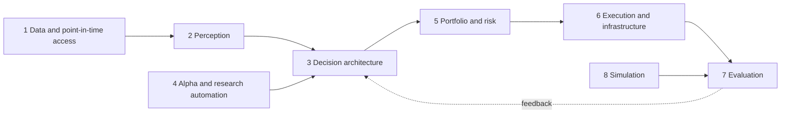

# The domain map

Every LLM or agentic trading system, however it is marketed, is some arrangement of eight jobs. A map by *job* is more useful than a list of repositories, because it shows which jobs a given project does, which it skips, and which nobody does well. Each entry in the [catalog](catalog/projects.md) is tagged with the layers it touches. Counts, generated from the catalog:

<!-- atlas:layer-counts -->
| Layer | Papers (primary layer) | Projects (primary layer) | Projects (any layer) |
|---|---|---|---|
| Data and point-in-time access | 1 | 5 | 9 |
| Perception (text and numbers into signals) | 9 | 4 | 4 |
| Decision architectures | 15 | 13 | 14 |
| Alpha and research automation | 7 | 3 | 4 |
| Portfolio, risk and RL | 3 | 2 | 2 |
| Execution and infrastructure | 0 | 5 | 13 |
| Evaluation, benchmarks and bias control | 17 | 5 | 14 |
| Simulation | 0 | 2 | 3 |
| Surveys | 5 | 0 | 0 |
| **Total** | **57** | **39** | |
<!-- /atlas:layer-counts -->

The map has one rule: **information flows left to right in time, and evaluation reads what execution did.** A common failure in published systems is a layer boundary that leaks, for example a test window that the decision layer's model has already read.

## The eight layers

### 1. Data and point-in-time access
*Question:* what did the system know, and when did it know it?
*Failure modes:* restated fundamentals overwriting the originals, news timestamps that are crawl times, survivorship in the universe, adjusted prices that embed later splits.
*Catalog:* [FNSPID](https://arxiv.org/abs/2402.06698) (a financial news dataset aligned with prices) is the one dedicated data paper we hold; Qlib, OpenBB, the Alpaca MCP server and three market-data MCP servers (Yahoo Finance, Financial Datasets, Massive) are the data-facing projects. The MCP servers are live-data tools; we did not check any of them for point-in-time guarantees. Qlib, a quant platform rather than an agent framework, has a point-in-time database for fundamentals; none of the agent frameworks we read ships a point-in-time store of its own. That gap is what the [frozen world](04-fair-evaluation.md#2-the-frozen-world) in our evaluation design fills.

### 2. Perception
*Question:* how are text and numbers turned into usable signals?
*Failure modes:* invented figures, wrong period or currency, sentiment that is mostly the headline's tone, prompt injection through news text.
*Catalog:* papers such as BloombergGPT, PIXIU, Fino1, Fin-R1, financial-statement analysis with LLMs, sentiment trading, ChatGPT return prediction, factor-and-newsflow fusion and FinRobot; projects FinGPT, FinRobot, Qwen DianJin and PIXIU. The pattern worth copying is [numbers by code, narrative by model](teardowns/finrobot.md).

### 3. Decision architecture
*Question:* given the signals, what is the call, and how is it argued?
*Designs:* a role-based firm ([TradingAgents](teardowns/tradingagents.md)), a single agent with layered memory ([FinMem](teardowns/finmem.md)), a tournament that weights agents by realized results ([ContestTrade](teardowns/contesttrade.md)), a manager-analyst hierarchy (FinCon), an end-to-end trained reasoning model (Trading-R1), a technical-analysis pipeline (QuantAgent).
*Failure modes:* debate as theatre (same model arguing with itself), conclusions driven by the persona prompt, no baseline against one call.
*Catalog:* the layer with the most projects and the noisiest claims.

### 4. Alpha and research automation
*Question:* can a model discover tradable signals rather than make trades?
*Designs:* formulaic alpha mining with LLMs (Alpha-GPT, AlphaAgent, AlphaForge and others), agentic research loops (R&D-Agent-Quant, QuantaAlpha, FactorMiner).
*Failure modes:* data snooping at scale, overfitting through repeated LLM-proposed trials, decay not modeled.
*Catalog:* projects Qlib, RD-Agent, QuantaAlpha and AlphaGen. This layer has the best statistical hygiene when it has any, because mined factors are evaluated by information coefficient on held-out data before anyone trades them.

### 5. Portfolio and risk
*Question:* how much, in what proportions, and when to stand down?
*Designs:* classical allocation, reinforcement-learning allocators, timing overlays, volatility scaling ([FinRL-X](teardowns/finrl-x.md), FinRL).
*Failure modes:* position size left to the model, a "risk agent" that only writes prose, no exposure or loss limit enforced in code.
*Catalog:* none of the 151 arXiv papers the four lists link is, by its title, about risk control for an LLM trading agent; the closest is FinRL-DeepSeek (an LLM signal inside a risk-sensitive RL agent), which is catalogued. We searched only those lists ([methodology](07-methodology.md#scope-and-limits)), so this describes the lists, not the whole field. Either way it is the layer where an engineering contribution is most needed.

### 6. Execution and infrastructure
*Question:* how does a decision become a fill, safely?
*Designs:* event-driven engines (Lean, NautilusTrader), broker bridges and MCP servers (Alpaca MCP, fintool), the weight-to-order executor in FinRL-X, and a cluster of prediction-market toolkits (Polymarket MCP, Kalshi bots, Oracle3) that hand an LLM an order tool.
*Failure modes:* an agent with an order tool and no guard, retries that double-submit, state lost on a crash, no reconciliation between intent and fills.

### 7. Evaluation
*Question:* is the result real?
*Designs:* bias-aware backtesting (FINSABER), live arenas (Agent Market Arena, DeepFund, LiveTradeBench, AI-Trader), post-cutoff benchmarks (StockBench), masking and attribution (KTD-Fin), cost-aware diagnostic scorecards (CLQT), fault injection (TradeTrap).
*Catalog:* the layer with the most papers. Several of these papers exist because the headline numbers elsewhere are not trusted. See [fair evaluation](04-fair-evaluation.md) and [reading a backtest](06-reading-a-backtest.md).

### 8. Simulation
*Question:* can we study behavior and mechanisms without risking capital or waiting years?
*Designs:* LLM investors in a simulated exchange (StockAgent), RL gyms (FinRL).
*Failure modes:* simulated markets with no impact, agents tuned to the simulator.
*Catalog:* three projects tag this layer (FinRL, StockAgent and the Polymarket paper-trading gym). The StockAgent paper is filed under evaluation, because it presents the simulator as a leakage-free way to study behavior.

## Where the five teardowns sit

| Project | Data | Perception | Decision | Alpha | Portfolio | Execution | Evaluation |
|---|---|---|---|---|---|---|---|
| [TradingAgents](teardowns/tradingagents.md) | tools only | analyst reports | **yes** | | | | decision-quality grid |
| [FinRobot](teardowns/finrobot.md) | 7 providers | **yes** | debate step | | | | self-hit-rate |
| [FinMem](teardowns/finmem.md) | pipeline only | summaries | **yes** | | | | |
| [ContestTrade](teardowns/contesttrade.md) | tools | **text factors** | **yes** | | Sharpe-weighted | | |
| [FinRL-X](teardowns/finrl-x.md) | **yes** | LLM sentiment | | | **yes** | **yes** | **yes** |

Read across a row to see what a project outsources to you; read down a column to see how few cover risk and execution. The four agentic systems and the one infrastructure project are complements more than competitors: FinRL-X's weight contract is the missing back half of the others.

## How we tag layers

A project gets a layer when it ships working code for that job, not when its README mentions it. The first layer listed is its primary layer, used to place it in the [project table](catalog/projects.md). Papers have a single primary layer.
