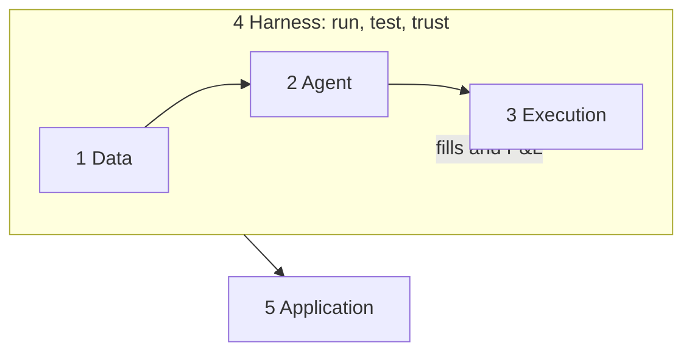

# The domain map

Every LLM or agentic trading system, however it is marketed, is some arrangement of five layers. A map by *layer* is more useful than a list of repositories, because it shows which jobs a given project does, which it skips, and which nobody does well. Each layer has a generated page under [`layers/`](../layers/README.md) with its repositories, papers, articles, failure modes and builder notes. Counts, generated from the catalog:

<!-- gen:layer-counts -->
| Layer | Repos (primary) | Repos (any layer) | Papers | Articles |
|---|---|---|---|---|
| [1. Data layer](../layers/data.md) | 10 | 14 | 5 | 5 |
| [2. Agent layer](../layers/agent.md) | 8 | 11 | 22 | 0 |
| [3. Execution layer](../layers/execution.md) | 6 | 10 | 1 | 0 |
| [4. Harness layer](../layers/harness.md) | 17 | 24 | 17 | 10 |
| [5. Application layer](../layers/application.md) | 11 | 11 | 8 | 2 |
| Surveys (span the stack) | | | 5 | |
| **Total** | **52** | | **58** | **17** |
<!-- /gen:layer-counts -->

The map has one rule: **information flows forward in time, and the harness reads what execution did.** A common failure in published systems is a layer boundary that leaks, for example a test window that the agent's model has already read.

## The five layers, and the jobs inside them

An earlier version of this map had eight jobs. They are all still here, grouped by who usually owns them:

| Layer | Jobs inside it | Question |
|---|---|---|
| [1. Data](../layers/data.md) | data and point-in-time access; perception (text and numbers into signals) | What did the agent know, and when did it know it? |
| [2. Agent](../layers/agent.md) | decision architecture; finance models; learned policies | Given the signals, what is the call, and how is it argued? |
| [3. Execution](../layers/execution.md) | portfolio-to-order pipelines; brokers and venues; engines | How does a decision become a fill, safely? |
| [4. Harness](../layers/harness.md) | evaluation; simulation; robustness; the agent runtime (loops, evals, traces, state) | Is the result real, and would we notice if it stopped being real? |
| [5. Application](../layers/application.md) | alpha and research automation; research desks; funds; prediction markets | What end-to-end job does it do for a user? |

Two placements are worth explaining:

- **Alpha research automation is an Application**, not part of the Agent layer, because its output is a factor library for people to use, not a trading decision. Its statistical hygiene (information coefficient on held-out data before anyone trades) is the best in the field when it is present.
- **Portfolio and risk are split.** Learned allocators live in the Agent layer; enforced limits (order value, turnover, exposure) belong to Execution, because a risk "agent" that only writes prose does not limit anything. None of the 151 arXiv papers that four popular lists link is, by its title, about risk control for an LLM trading agent; the closest, FinRL-DeepSeek, is catalogued. We searched only those lists ([methodology](07-methodology.md#scope-and-limits)), so this describes the lists, not the whole field.

## Where the five teardowns sit

| Project | Data | Agent | Execution | Harness | Application |
|---|---|---|---|---|---|
| [TradingAgents](teardowns/tradingagents.md) | tools only | **role-based firm** | | decision-quality grid | |
| [FinRobot](teardowns/finrobot.md) | 7 providers | debate step | | self-hit-rate | **research reports** |
| [FinMem](teardowns/finmem.md) | pipeline only | **layered memory** | | | |
| [ContestTrade](teardowns/contesttrade.md) | text factors | **tournament**, Sharpe-weighted | | | |
| [FinRL-X](teardowns/finrl-x.md) | **yes** | RL allocator, LLM sentiment | **weights to orders, guard** | **yes** | |

Read across a row to see what a project outsources to you; read down a column to see how few cover execution. The four agentic systems and the one infrastructure project are complements more than competitors: FinRL-X's weight contract is the missing back half of the others.

## How we tag layers

A project gets a layer when it ships working code for that job, not when its README mentions it. Its primary layer places it in the directory; other layers it ships code for are recorded in `also` and shown on those layer pages under "Also relevant". Papers have a single primary layer, except surveys, which span the stack.
