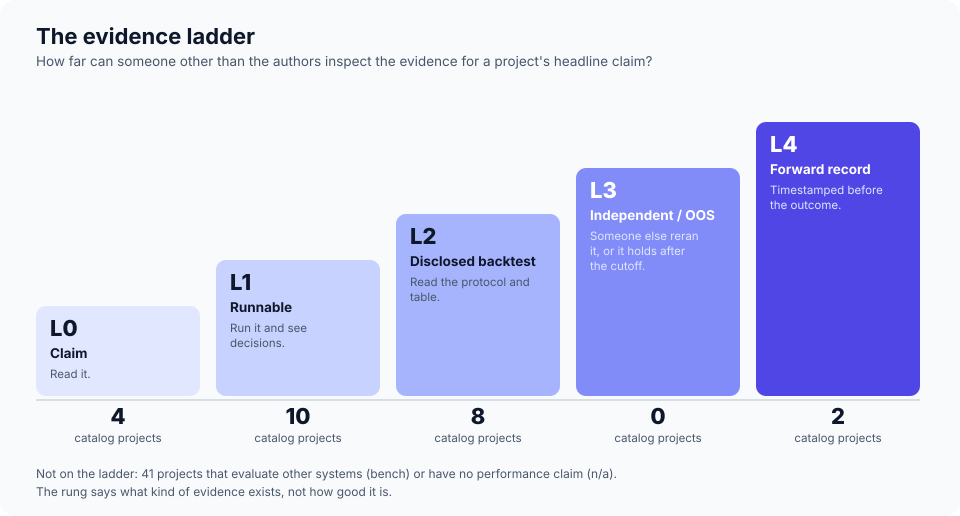

# The evidence ladder

Star counts say how popular a repository is. They say nothing about whether its headline number is true. This page defines the one grade we attach to every project: **how far up the ladder the evidence for its main performance claim can be inspected by someone other than its authors.**

| Rung | Name | What you can do with it | Typical artifact |
|---|---|---|---|
| **L0** | Claim | Read it. | A README or abstract with a number and nothing to run; a repository that is a single README. |
| **L1** | Runnable | Run the code and see the system produce decisions. | A working framework with no performance claim, or a claim with no harness. |
| **L2** | Disclosed backtest | Read a described protocol and a results table. Leakage and sampling error are possible and usually unquantified. | A paper with a backtest over a few months or a few tickers, one run, no interval. |
| **L3** | Independent or out-of-sample | Someone other than the authors reran it, or the result holds on data after the model's cutoff, with costs and an interval. | A third-party replication; a post-cutoff benchmark with uncertainty. |
| **L4** | Forward record | Decisions were timestamped before outcomes were known, for a period long enough to matter. | A live or paper-trading log with committed configuration. |

Two more labels cover things that are not trading claims: **bench** (the project evaluates other systems; judge its protocol, not a return) and **n/a** (infrastructure or a tool with no performance claim).

## How to assign a rung

1. Find the project's **headline performance claim**: the number in the README or abstract.
2. Ask the questions in order and stop at the first "no":
   - Can I run something? (L1)
   - Is the protocol and result table disclosed? (L2)
   - Has anyone else reproduced it, or is it on post-cutoff data with costs and an interval? (L3)
   - Were decisions committed before the outcome, over a record long enough to separate from luck (see [the minimum record length](06-reading-a-backtest.md#how-long-is-long-enough))? (L4)
3. Record **repro** separately: *full* (headline numbers can be regenerated from the repo), *partial* (code but not data, or data but not harness), *none*, *unverified* (we did not try), *n/a*.

The rung describes the kind of evidence, not its quality. An L4 record of three weeks is still too short to say much; an L2 backtest over eight years with costs may deserve more trust than an L4 week. Read the rung together with the window length.

## Where the catalog sits

<!-- gen:ladder-summary -->Of the 65 repositories in the [catalog](catalog/projects.md): 4 at L0, 10 at L1, 8 at L2, 0 at L3, 2 at L4, 6 benchmarks or arenas that evaluate other systems, and 35 infrastructure, data or tooling projects with no performance claim. On repro, 0 are graded "full", 5 "partial", 2 "none", and 33 "unverified" (we read the README and code but did not rerun them).<!-- /gen:ladder-summary --> **None reaches L3 on its own headline claim.** The nearest thing to L3 in the field is a paper, not a project: [FINSABER](https://arxiv.org/abs/2505.07078) reran FinMem and FinAgent on FinMem's own window and on two decades of data and found the reported advantage did not survive (see the [claim audit](05-claim-audit.md)).

That is the state of the field in one sentence: plenty of code, a few disclosed backtests, almost no independent evidence.

## Papers have a similar scale

For papers we record **read depth** rather than a rung: *full* (method and results read), *partial* (the sections that carry the claim), *abstract* (abstract only; the one-line summary in the catalog is a pointer, not a review), or *card* (a method card produced by the [extraction pipeline](07-methodology.md#method-cards) and quote-verified). A summary of a paper we only read in abstract is labelled as such.

## What to do with a rung

- **Choosing what to build on:** prefer high rung and high repro. A designed-to-be-reproducible L1 beats an unreproducible L2 for engineering purposes.
- **Choosing what to compare:** anything L2 or below needs to be rerun under the [same-budget protocol](04-fair-evaluation.md) before its number is placed in a table next to another system's.
- **Citing:** cite the rung with the number: "26.6% (L2, 3 months, one run)".
