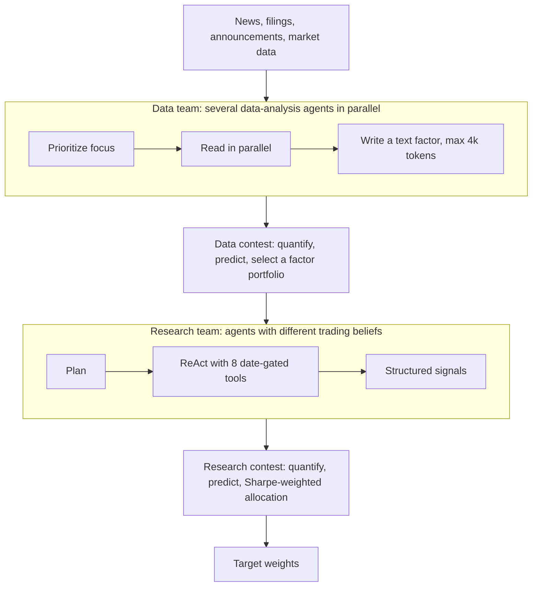

# ContestTrade

> A two-level tournament: data analysts compete to write the best text factors, research agents compete to turn them into trades, and capital flows to whichever agents a small model predicts will have a good Sharpe next. The idea is borrowed from online expert selection and it is the most quantitatively disciplined design here. The paper is also the most candid about its limits. The repository, however, does not contain the backtest.

| | |
|---|---|
| Repo | [FinStep-AI/ContestTrade](https://github.com/FinStep-AI/ContestTrade) · Apache-2.0 · 680 stars (2026-10-21) |
| Paper | [arXiv 2508.00554](https://arxiv.org/abs/2508.00554) · v1 2025-08-01, latest v5 2026-08-20 (numbers below are from v5) |
| Snapshot read | commit `22432f9`, last commit 2025-12-22 (PT) |
| Layer | Decision architecture |
| Evidence | **L2** (disclosed protocol, post-2024 A-share window, six months) · repro **partial** |
| Read depth | Teardown: v5 paper read in full; `README_en.md`, the contest, predictor and weight-optimizer modules read in code |

## 1. What it is

Two teams, each ruled by the same three-step contest: **Quantify** each agent's past output, **Predict** its next-period utility, **Allocate** weight to agents with positive predicted utility.

## 2. How the contest works

- **Quantify (data team).** Each text factor is scored by a *zero-intelligence trader*: a model reads a single observation from the factor with no external context, rates the symbols it mentions on a five-point scale (−2 to +2), and the reward is that rating times the next-day price change. The score is computed only after the next-day return is observable and is used for future selections, never for the same day.
- **Quantify (research team).** A hybrid of the trailing realized Sharpe of the agent's past signals and an LLM judge panel's 1–5 rubric scores for logic, evidence quality, risk awareness and consistency. The judge prompts hide agent identifiers.
- **Predict.** A LightGBM model, trained on a rolling basis with only labels realized strictly before the decision day, maps an agent's recent score history (trailing mean, volatility, trend, drawdown) to a predicted mean and volatility of its future score. Predicted utility is `μ̂ / max(σ̂, 0.01)` in the code (`predictor.py`, `research_predictor.py`).
- **Allocate.** Data team: pick the factor set that maximizes summed value under a sigmoid penalty for context length (a heuristic, as the paper says). Research team: weight every agent whose predicted Sharpe is positive in proportion to that Sharpe; if none is positive, every weight is zero (`research_weight_optimizer.py`). The final portfolio is therefore a **Sharpe-weighted ensemble**, not one selected view.

The empirical premise is that an agent's quality shows short-term momentum: the paper says the rank correlation between a trailing 5-day score and the next 3-day score is stronger than at longer horizons in its validation period. As evidence that the contest scores carry information, it reports Rank IC 0.054 and ICIR 0.13 for the data contest and Rank IC 0.079 and ICIR 0.18 for the researcher contest.

## 3. Data and tools

A-share news, announcements, financials and market data (Tushare and others), plus an English configuration for US equities (FMP, Alpha Vantage, Polygon keys required). Research agents have eight tools. Every call is parameterized by the decision date and records are filtered by release timestamp, so an agent cannot see anything published after portfolio formation; a failed tool call is retried once and then treated as missing evidence rather than filled with later information.

## 4. Decision loop

Per decision day: data agents refresh factors → data contest → research agents plan, call tools and emit structured signals (symbol, action, confidence, evidence, risk factors, holding horizon) from "trading beliefs" such as momentum, reversal, fundamentals, event-driven and risk control → research contest → Sharpe-weighted weights → trade. Realized returns from t+1 onward update contest scores only after they are observed.

## 5. Risk

Risk control is partly learned and partly a belief prompt. The learned part is real: agents with a non-positive predicted Sharpe get zero weight, and the "w/o Deep Research" ablation shows tool use mattering most for drawdown. There is no explicit exposure cap, volatility target or stop in the paper's description; the backtest respects A-share frictions (T+1 settlement, daily price limits, suspension, ST-stock exclusion) with a 0.001 transaction cost.

## 6. Evaluation as reported (v5)

- **Test window January–June 2025**, A-shares; internal model training and validation on July–December 2024 or earlier realized labels.
- Backbone DeepSeek-V3, switching to DeepSeek-R1 for critical signal generation; prompts fixed over the test period.
- Same universe, window, cost (0.001) and trading constraints for all baselines.

| Strategy | Cumulative return | Sharpe | Max drawdown |
|---|---|---|---|
| CSI ALL Share (index) | 4.42% | 0.46 | 13.75% |
| MACD / RSI&KDJ | 2.69% / 8.19% | 0.10 / 0.47 | 10.65% / 8.30% |
| LGBM / LSTM | −25.94% / 8.34% | −1.30 / 0.51 | 34.17% / 29.56% |
| A2C / PPO | 7.89% / 15.07% | 0.69 / 1.33 | 18.84% / 17.11% |
| MASS (multi-agent) | −19.12% | −1.76 | 24.55% |
| **ContestTrade** | **52.80%** | **3.12** | **12.41%** |

Ablation (Table 3): without contest mechanisms *and* tools and judge ("w/o All") the result is 3.01% / 0.07 / 26.63%, close to the index; removing only the researcher contest gives 32.83% / 1.78; removing only the data contest gives 42.85% / 2.01.

## 7. What we checked

| Check | Result |
|---|---|
| Can the table be regenerated from the repo? | **No.** The repository has no backtest code. Its own roadmap lists "Visual backtesting and analysis interface" as an unchecked future item, and the V2.0 milestones mark US-stock access and richer factors as finished. |
| Does the paper describe a one-shot or a weighted selection? | A weighted ensemble: positive-predicted-Sharpe agents share weight in proportion. The LLMQuant list describes the project as agents competing "before one view is selected for the final decision", which does not match the paper or the code. |
| Is the contest actually earning its keep? | The ablation says yes for this window, and "w/o All" landing near the index is the most informative number in the paper: the LLM research agents without the contest machinery are close to passive. It is a single run per configuration; the paper says so. |
| Leakage controls | Unusually explicit: release-timestamp filtering on every tool call, delayed score updates, rolling label-realized training, post-2024 window. The paper adds that knowledge cutoffs alone cannot rule out leakage, which is why it relies on the decision-time protocol. It does not report a masking or look-ahead-propensity test. |
| Statistical support | The paper's own limitations paragraph states the evidence: "a single controlled backtest" with "no confidence intervals from repeated LLM sampling, bootstrap tests, or longer walk-forward evaluations", six months, one market. |
| Baseline fairness | Baselines share universe, window and costs. The LGBM baseline is a price-only cross-sectional model; the paper notes that it is not the same model as the LightGBM used to predict agent utility. |

## 8. Honest limitations

- Six months of one market, one run, no interval. A Sharpe of 3.12 over half a year has a standard error of about 1.4, so a 95% interval of roughly 0.3 to 5.9 (iid normal approximation; see [reading a backtest](../06-reading-a-backtest.md)).
- The cost of the research team (tool-using agents per decision) is not reported alongside the return, so efficiency cannot be compared.
- A-share T+1 and price-limit rules matter: results do not transfer to US intraday or to a market with shorting.
- Capacity and market impact are explicitly not modeled.
- The repository is an application of the idea (CLI, configs, prompts), not an evaluation harness.

## 9. What to steal

1. **Score every agent on delayed realized outcomes, then weight by predicted utility.** This is a general mechanism: it works for debate roles, tools and prompts, not only for stock-picking agents.
2. **Zero-intelligence-trader scoring of text factors**: a cheap, context-free way to ask "did this piece of text carry signal".
3. **Date-parameterized tools with release-time filtering**, and "failed call means missing evidence".
4. **Zero weight when predicted utility is non-positive.** Cash is a valid output.
5. **The candor.** The limitations paragraph is a template for how to end a methods paper.

## 10. How we would test it fairly

The mechanism is the thing to test, so the comparison is **contest versus no contest at equal spend**. Keep the same agents, the same tools, the same backbone and the same per-decision token budget; vary only the allocation rule (Sharpe-weighted contest, equal weight, best-trailing-agent, random). Run it over at least one window that does not overlap the authors' January–June 2025, report the token and dollar cost per decision for each arm, and bootstrap the Sharpe difference with a block bootstrap so that the answer carries an interval ([protocol](../04-fair-evaluation.md)). If the contest's edge over equal weighting vanishes at equal spend, the mechanism is not what produced the 3.12.
