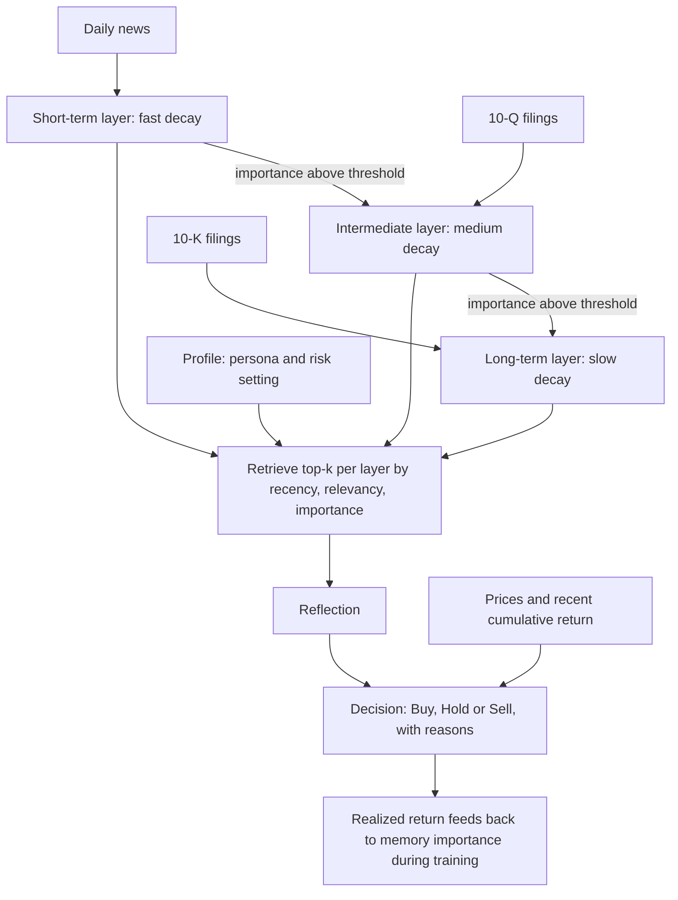

# FinMem

> One trading agent with a risk persona and a memory that forgets at three different speeds. The memory design is the contribution, and it is a good one. The headline result is the part to hold at arm's length: it is a best-of-three choice made on the test window, over about six months, with backbones whose training data plausibly includes that window.

| | |
|---|---|
| Repo | [pipiku915/FinMem-LLM-StockTrading](https://github.com/pipiku915/FinMem-LLM-StockTrading) · MIT · 962 stars (2026-10-21) |
| Paper | [arXiv 2311.13743](https://arxiv.org/abs/2311.13743) · v1 2023-11-23, version read: v2 (2023-12-03) |
| Snapshot read | commit `be814aa`, last commit 2024-08-17 (PT) |
| Layer | Decision architecture |
| Evidence | **L2** (disclosed backtest; ~6-month test window; selection on test) · repro **partial** (the repo ships no market data) |
| Read depth | Teardown: paper read in full, `puppy/agent.py`, `run.py`, configs and the data pipeline read in code |

## 1. What it is

A single agent per ticker. Each trading day it reads new text (news, and 10-Q and 10-K filings) and prices, stores summaries in memory, retrieves what it considers relevant, reflects, and emits Buy, Hold or Sell. The agent is told who it is (a persona string describing its sector expertise and risk attitude) and can be set to risk-seeking, risk-averse, or self-adaptive (switch on recent cumulative return).

## 2. Architecture

From the code and sample configuration (`puppy/agent.py`, `config/*.toml`):

- **Three long-term layers with different clocks.** The sample config sets the recency decay constant to 3 days for the shallow layer, 90 for the intermediate and 365 for the deep one, with importance decaying at 0.92, 0.967 and 0.988 per step. Items are promoted from shallow to intermediate to deep when their importance score crosses thresholds (60, then 80 in the sample), and cleaned up below a recency or importance floor.
- **Retrieval score** combines recency, relevancy (embedding similarity) and importance, following the generative-agents recipe. The paper retrieves the top 5 per layer; the sample config sets `top_k = 3`.
- **Working memory** holds the day's observation, summarization and reflection.
- **Train and test modes.** In train mode memory is populated and the agent's actions are *constructed from the realized next-day return* (`_construct_train_actions`: long if the future return is positive, short otherwise), and the realized return updates the access and importance counters of the memories involved. In test mode the agent decides on its own and cannot see future prices; it uses cumulative return over the previous M trading days as its momentum signal.

## 3. Data

Yahoo prices (`yfinance`), Alpaca news, SEC filings, from 2021-08-17 to 2023-04-25 in the paper. The repository ships **no market data**: the data folders contain only placeholders, and the one sample archive is named `Fake-Sample-Data.zip`. You get the pipeline code, not the dataset, so the paper's table cannot be regenerated from the repo.

## 4. Decision loop

Daily, per ticker: ingest → score importance → retrieve per layer → summarize and reflect → decide → (in training) learn from the realized return. The training path uses a signed unit action (`quantity: 1`); we did not find position sizing beyond that.

## 5. Risk

Risk is a **persona**, not a constraint: "risk-averse" and "risk-seeking" are system-prompt text, and "self-adaptive" switches the text based on recent return. Nothing in the code limits exposure, drawdown or turnover. The paper's own ablation shows the persona changes results a great deal, which is evidence of sensitivity, not of risk control.

## 6. Evaluation as reported

- Train 2021-08-17 → 2022-10-05; test **2022-10-06 → 2023-04-10** (about six months); five tickers (TSLA, NFLX, AMZN, MSFT, COIN). COIN is compared only against the other LLM agents; the paper explains that Coinbase listed in 2021, too late for the ten-year training window the DRL baselines use.
- Baselines: buy-and-hold, Generative Agents, FinGPT, and A2C, PPO and DQN trained on roughly ten years (2012-01-01 → 2022-10-05).
- Backbone: GPT-4-Turbo, temperature 0.7. Metrics averaged over five repeated trials. A Wilcoxon signed-rank test marks significance.
- Table 2 cumulative returns for FinMem: TSLA 61.78% (Sharpe 2.68; buy-and-hold −18.63%), NFLX 36.45%, AMZN 4.89%, MSFT 23.26%, COIN 34.98%.
- Ablations on TSLA over a still shorter window (2022-06-16 → 2022-12-28): GPT-4 62.6%, GPT-4-Turbo 54.7%, GPT-3.5-Turbo 16.2%, Llama-2-70b-chat −52.7%.

## 7. What we checked

| Check | Result |
|---|---|
| Selection on the test set | The paper says FinMem was run with each of its three risk settings and that "the reported performance outcomes are based on the setting that achieved the highest cumulative return during the testing phase." That is best-of-three picked on the test window. The other agents had no comparable free choice. |
| Training labels | In train mode the action is derived from the realized future return. That is legitimate for filling memory, but it means the training period is label-informed by construction and the comparison to DRL baselines is not like for like. |
| What drives retrieval | All four memory queries in `agent.py` (shallow, intermediate, deep, reflection) use the **persona string** as the query text. The day's news does not enter the retrieval query. Relevancy is therefore relevance to the persona, not to today's situation, which weakens the claim that the memory "filters and prioritizes" information for the current decision. |
| Window length | About six months. See [reading a backtest](../06-reading-a-backtest.md): at this length a Sharpe difference of 0.5 between two strategies that are 0.9 correlated needs roughly 3 years to resolve. |
| Could the backbone know the window? | The paper says "GPT-4-Turbo" without a snapshot. The 1106 preview is listed by Azure with an April 2023 cutoff, which is after the end of the test window. Memorization of the period is **not ruled out**, and no look-ahead test is reported. |
| Reproducibility | No data in the repo, last update 2024-08-17, and the cost of rerunning with a frontier model is on you. Rated repro: partial. |

## 8. Honest limitations

- One short window; the strongest numbers come from the most volatile ticker (TSLA, buy-and-hold −18.63% in the paper's Table 2).
- The risk setting, the one hyper-parameter that matters most, is tuned on the test period.
- The persona-keyed retrieval is a design choice that deserves its own ablation (query by today's news instead) and has none.
- The comparison set mixes agents trained for months with agents trained for ten years, and uses different action spaces.
- The repository has not changed since August 2024, so it does not track current model APIs.

## 9. What to steal

1. **Layered memory with explicit clocks.** News, quarterly and annual information should decay at different rates and promote on importance. This is the clearest memory design in the field.
2. **Importance updated by realized outcome.** Feeding realized return back into memory importance is a simple credit-assignment loop.
3. **A persona that is a parameter**, so risk attitude is an input you can sweep rather than prose you edit.
4. **Retrieval that is auditable**: every decision logs the top-k memories per layer.

## 10. How we would test it fairly

Run the [same-budget design](../04-fair-evaluation.md) with three changes specific to FinMem. First, fix the risk setting *before* the test window (or run all three and report all three, as an ablation, never as a pick). Second, add the missing retrieval ablation: persona-keyed versus news-keyed queries. Third, use a window that starts after the backbone's cutoff, mask tickers and dates in a second arm ([leakage controls](../04-fair-evaluation.md#6-contamination-controls)), and report the memory layers on and off at equal token spend, since the memory is exactly the thing that adds tokens.
