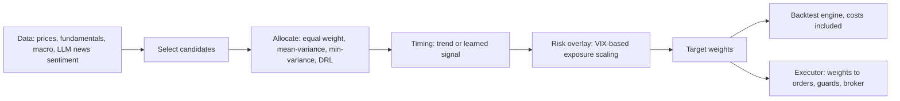

# FinRL-X (FinRL-Trading)

> Not an LLM agent. It is the plumbing that most LLM agents lack: one object, the target weight vector, passes from strategy to backtest to broker, so what you tested is what you trade. Its paper reports a short forward paper-trading record and is honest that the table's job is to show the pipeline works. Read it for the interface, not for the returns.

| | |
|---|---|
| Repo | [AI4Finance-Foundation/FinRL-Trading](https://github.com/AI4Finance-Foundation/FinRL-Trading) · Apache-2.0 · 3.8k stars (2026-10-21) |
| Paper | [arXiv 2603.21330](https://arxiv.org/abs/2603.21330) · v1 2026-03-22, the only version (read) |
| Snapshot read | commit `4409abe`, last commit 2026-09-17 (PT) |
| Layer | Portfolio and risk · execution · evaluation |
| Evidence | **L2** for the backtests; the paper-trading window is a short, self-reported forward record (see §7) · repro **unverified** (we did not rerun it) |
| Read depth | Teardown: paper read in full; settings, executor, backtest engine and strategy modules read in code |

## 1. What it is

The successor to the original FinRL library, reframed as a trading *system*. Every strategy, however it is built, is a function that returns a vector of target portfolio weights `w_t`. The paper writes it as four composable transformations:

`w_t = R(T(A(S(data up to t))))`, with **S** stock selection, **A** allocation, **T** timing and **R** a portfolio-level risk overlay.

LLMs appear only at the edge (news turned into structured sentiment before it enters the strategy). The system is useful to an LLM trading agent because it shows the contract an agent's output should end in.

## 2. Data

FMP as the primary vendor, Yahoo and WRDS as alternatives, with a SQLite cache and raw snapshots persisted so that an offline experiment and a live run see the same schema. News text is converted into structured sentiment by an LLM preprocessing step. All series are aligned to a shared trading calendar.

## 3. Decision loop

Rebalance on a schedule (the sample settings default to quarterly for stock selection; the paper's paper-trading run rebalances daily): select, allocate, time, overlay, then emit weights. There is no free-form reasoning step and no per-decision LLM spend beyond the sentiment preprocessing. Learned components (the DRL allocator, the ML stock-scoring model) are evaluated with rolling out-of-sample validation, according to the paper.

## 4. Risk and execution (this is the instructive part)

In code:

- **Concentration caps at construction.** The ML strategy caps a single stock at 10% and a sector at 30% by default, redistributing freed weight.
- **Executor guards** (`trading/trade_executor.py`): any order whose value exceeds `max_order_value` (default $100,000) is **dropped**, an order that cannot be priced is dropped, and if total turnover exceeds `max_portfolio_turnover` (default 50% of the portfolio) every remaining order is scaled down proportionally.
- **State persistence, structured logs and reconciliation** are described in the paper as the answer to the paper-to-live gap; we did not exercise them.
- **Backtest costs.** The `bt`-based engine charges 0.1% per trade by default (10 bps, matching the paper) and can take a custom cost model.

Two observations worth keeping. First, a guard that *drops* an over-limit order rather than splitting or clipping it can quietly leave a book far from its target on exactly the largest rebalances; log it and treat it as a drift alarm. Second, a flat 10 bps says nothing about spread, impact or borrow, which matter far more for small-caps and leveraged ETFs.

## 5. Evaluation as reported

- **Backtest** 2018-01-07 → 2025-10-24, liquid US equities and ETFs, SPY and QQQ as benchmarks, 10 bps per side, rolling out-of-sample validation for learned parts.
- **Paper trading** on a broker's paper environment 2025-10-26 → 2026-03-12, an ensemble of "Rolling Selection" and "Adaptive Rotation" with daily rebalancing.

Table 2 (allocation paradigm, with and without timing). Values are Sharpe ratios:

| Strategy | No timing | With timing |
|---|---|---|
| Equal weight | 0.54 | 0.87 |
| Mean-variance | 0.53 | 0.74 |
| Min-variance | 0.63 | 0.90 |
| DRL allocator | 0.55 | 0.89 |
| *SPY / QQQ* | *0.84 / 0.95* | |

Paper-trading summary (Table 4): total return 19.76% for the strategy versus −2.51% (SPY) and −4.79% (QQQ); Sharpe 1.96; maximum drawdown −12.22%.

## 6. What the numbers say (and do not)

Read Table 2 plainly: timing helps every base allocator, and **none of the nine strategy rows beats QQQ's Sharpe of 0.95**; only the timing variants of equal-weight, min-variance and DRL (0.87, 0.90, 0.89) edge past SPY's 0.84. The reinforcement-learning allocator without timing (0.55) is level with equal weight (0.54); a gap of 0.01 is far inside any plausible error band over seven years. The paper's own text claims modularity, not alpha, and its numbers are consistent with that.

## 7. What we checked

| Check | Result |
|---|---|
| Table 2 versus Table 3 | The same benchmark ETFs over the stated 2018–2025 horizon show different numbers in two tables: SPY Sharpe 0.84 and max drawdown −23% (Table 2) versus 0.72 and −33.7% (Table 3); QQQ Sharpe 0.95 versus 0.81 and cumulative multiple 3.61 versus 4.02. Each table is internally consistent (the Calmar ratios follow from the return and drawdown columns). Figure 2 is titled "Mar 2018 – Oct 2025" while the setup says January 7, 2018, which would explain a different start, but the paper does not say so. Do not mix a strategy from one table with a benchmark from the other. |
| Is the forward record informative? | It is the right kind of evidence (time-stamped, broker environment), but the window is about 19 weeks, self-reported, on a paper account, and the strategy is an ensemble chosen after the backtests. A Sharpe of 1.96 needs roughly 0.7 years of data before it separates from zero at one-sided 95% under iid returns ([minimum record length](../06-reading-a-backtest.md#how-long-is-long-enough)), so the window is too short to say more than "it ran". |
| Context of the window | Both benchmarks fell during it (SPY −2.51%, QQQ −4.79%), and the paper reports a 12.2% drawdown tied to an extreme move in a leveraged instrument, which it treats as a risk-module stress case rather than a headline. |
| Does the code do what the paper says about weights? | The executor takes `target_weights` and converts them to orders (`_weights_to_orders`), and the backtest consumes the same weights; we did not run either end to end. |
| Is the DRL result a real finding? | No claim of one: DRL without timing is level with equal weight. |

## 8. Honest limitations

- Not rerun by us; the repro grade is "unverified", the only one in this teardown set.
- Backtest costs are a flat rate; no spread, impact or borrow.
- The rolling-selection use case takes "all component stocks of the NASDAQ 100" as candidates; the paper does not say whether membership is point in time, which matters for survivorship. Check before trusting that row.
- The strongest live-looking number is a ~4.5-month paper-account window in which the benchmarks were negative.
- It is infrastructure; it does not solve alpha, and it has almost no LLM content.

## 9. What to steal

1. **The weight contract.** Make every strategy's output a target weight vector with explicit leverage rules, and have both the simulator and the broker consume it. Then "what we tested" and "what we traded" cannot drift apart.
2. **Four named stages (select, allocate, time, overlay)** so each can be ablated separately, which is exactly how Table 2 isolates timing.
3. **Paper-to-live gap as a first-class concept**, with deployment indicators (order rejection rate, guard triggers, tracking error between target and realized weights).
4. **Executor guards as data**, not code: order value, turnover and concentration limits in a settings object that logs when they bite.

## 10. How we would test it fairly

FinRL-X is the *harness* the other four lack, so use it as one: run an LLM agent's rating through the fixed rating-to-weight table into FinRL-X's backtest engine with its cost model, next to its equal-weight and timing baselines, under the [same-budget design](../04-fair-evaluation.md). The LLM agent then competes with a plain trend-timing overlay on equal terms. For FinRL-X itself, the useful test is a rerun: regenerate Table 2 from the repository with a fixed seed, then extend the window past October 2025 without changing any parameter.
