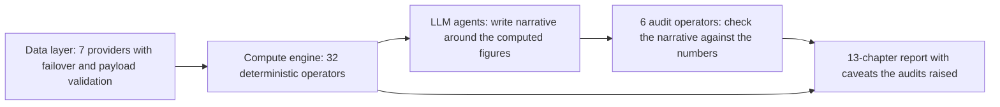

# FinRobot

> An equity-research workstation, not a trading system. Its useful idea is a rule about who is allowed to produce a number: code computes every figure, the model writes the prose, and audit operators check the prose against the figures. Read it as a pattern for the perception layer, not as a trading benchmark.

| | |
|---|---|
| Repo | [AI4Finance-Foundation/FinRobot](https://github.com/AI4Finance-Foundation/FinRobot) · Apache-2.0 · 8.3k stars (2026-10-21) |
| Paper | [arXiv 2405.14767](https://arxiv.org/abs/2405.14767) · v1 2024-05-23, version read: v2 (2024-05-27); the AutoGen-era platform paper |
| Snapshot read | commit `2717499`, last commit 2026-09-28 (PT) |
| Layer | Perception, with a debate step in the decision layer |
| Evidence | **L1** (runs; no trading-performance claim to test) · repro **partial** |
| Read depth | Teardown: V0 paper read in full; V2 desktop README and its backtest, aggregation and compute modules read in code |

## 1. Three generations in one repository

The name covers three different things, which is the first source of confusion.

| Generation | Folder | What it is |
|---|---|---|
| V0 | `finrobot_autogen/` | The AutoGen library behind the 2024 whitepaper: a four-layer platform idea with a "financial chain of thought" prompting scheme and a smart scheduler for choosing among LLMs. |
| V1 | `finrobot_equity/` | A self-hosted web app that generates equity-research reports. |
| V2 | `finrobot_desktop/` | A desktop app (Tauri shell, FastAPI and PydanticAI backend, React UI) that produces a 13-chapter research artifact per ticker. The README calls it the production generation. |

The paper describes V0. Most of what is worth reading today is V2.

## 2. The idea worth taking: numbers by code, judgment by model

The V2 README states the contract plainly: the model never emits a figure that cannot be traced to a call in `finrobot/engine/compute/`. Concretely:

- **26 compute operators** (DCF, DDM, LBO, multiples, Monte Carlo, sum-of-the-parts, residual income, peer screen, forward estimates, ownership, catalysts, a signal classifier and others) and **7 coordinators** that assemble their inputs. Pure Python, no model in the loop.
- **6 audit operators**: `currency_caliber`, `ev_bridge`, `narrative_divergence`, `narrative_numeric_grounding`, `sector_sign` and `ttm_period`. They read the narrative and flag drift from the numbers.
- **Typed pipelines** (equity research, DCF, DDM, LBO, comps, earnings, IC memo) built from steps with validators and retry, instead of an open-ended agent conversation.
- **Nine agents** defined by markdown instruction files: a data-to-report chain, a bull, a bear and a judge, and an orchestrator.
- **When methods disagree, withhold the point.** The README's football-field example shows DCF, forward P/E and EV/EBITDA diverging 2.6×; the report ships the range and no point target.

This is the most reusable thing in the project. A model asked to "write the Sharpe" or "quote the P/E" will sometimes invent it; a model asked to *describe* a figure that code already computed has far less room to. Every perception module in a trading agent should work this way.

## 3. Data

Seven providers behind one interface with health tracking and failover: Yahoo, SEC EDGAR, FMP, Finnhub, a retail-sentiment source, a news aggregator and FX. Responses are cached, and a validator rejects malformed payloads before they reach the compute layer.

## 4. Decision loop

There is no trading loop. The closest pieces are a bull/bear/judge debate inside the research pipeline and a backtest module:

- `engine/backtest/strategy_agent.py` lets an LLM tune a strategy's parameters for three iterations on an **in-sample** slice (70% of the window), then evaluates the winning parameters **once** on the untouched tail and returns that result. If the window is too short for an honest holdout it says so in a warning and flags the number as likely overfit. The default strategy is an SMA crossover run through BackTrader. This is a good discipline for LLM-in-the-loop tuning, but it tunes a toy strategy.
- `engine/compute/operators/signal.py` and `engine/aggregations/hit_rate_overview.py` score past research artifacts against their own targets with a three-state signal. A call is a **hit** if the price is within ±10% of the target or has moved more than half the way toward it, **failed** if it moved more than 10% the wrong way, and **watching** otherwise (and always during a 7-day grace period). The hit rate is hits over closed (hit or failed) calls, reported per verdict (BUY/HOLD/SELL) next to the average excess return over the S&P 500. The bands are generous and a call that drifts sideways stays "watching" indefinitely, so the rate is conditional on the price path; it is outcome feedback, not a calibrated accuracy.

## 5. Risk

Risk here means valuation risk, not portfolio risk: sensitivity tables, Monte Carlo around DCF inputs, the audit operators, and the explicit refusal to publish a point estimate when methods disagree. There is no position sizing, exposure limit or execution.

## 6. Evaluation as reported

The V0 paper's "performance evaluation" is two demo applications, not a backtest: a market-forecaster agent shown on one US and one Chinese example (Nvidia and Kweichow Moutai), and a report-generation application with sample reports in the appendix. The forecaster is described as a fine-tuned FinGPT-Forecaster on Llama-2-7b with LoRA over the latest year's Dow 30 and SSE 50. The paper publishes **no return, Sharpe or accuracy table**. The V2 README publishes none either; its quantitative claims are about engineering (32 operators, 6 audits, 7 providers, 237 test files, CI on Python 3.11/3.12 and Node 22/24).

## 7. What we checked

| Check | Result |
|---|---|
| Does the project make a trading-performance claim? | No. Nothing to reproduce or refute; we rate it L1 (code runs) and say so rather than inventing a score. |
| Do the V2 counts match the tree? | The README's counts (26 operators, 6 audits, 7 coordinators, 7 providers, 9 agents, 7 pipelines) are stated consistently in its own prose; we did not re-count the 237 test files. |
| Is the held-out-tail rule enforced in code? | Yes: the module splits at a fraction constant, requires a minimum tail length, and returns the out-of-sample result. |
| Is the audit layer evidence of correctness? | No. It checks narrative against computed numbers; it cannot tell you the inputs were right. Provider data can still be wrong or stale. |

## 8. Honest limitations

- It does not trade, size or manage a portfolio. Including it in a list of trading agents mixes categories.
- Three generations share a name; a citation to "FinRobot" without a version is ambiguous.
- Grounding in computed figures reduces invented numbers but not wrong judgment: an eloquent thesis around correct numbers can still be a bad call, and the hit-rate roll-up (the only outcome feedback) uses lenient bands and covers the project's own past reports.
- The V0 evaluation is anecdotal.

## 9. What to steal

1. **The numbers-by-code contract** for every perception and report module.
2. **Narrative-versus-number audit operators**, especially currency caliber, trailing-period and sign checks, which catch the mistakes LLMs actually make with financial text.
3. **Withhold the point when methods diverge**; ship the range.
4. **Scoring every report against its own stated target** with an explicit open/hit/failed state and excess return versus the index, so the desk accumulates a track record by default.
5. **In-sample tuning, one shot out-of-sample** whenever a model proposes parameters.

## 10. How we would test it fairly

It is not a trading system, so there is nothing to benchmark head to head. The fair test is *module level*: give the same filings to FinRobot's pipeline and to a single-call baseline, extract every numeric claim from each narrative, and score the fraction that match a ground-truth computation (the same method the [claim audit](../05-claim-audit.md) uses on papers). Then feed both report types to the same downstream rating step and compare decisions under the [same-budget protocol](../04-fair-evaluation.md).
