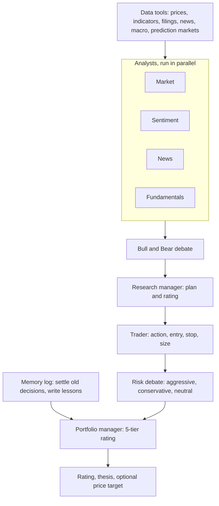

# TradingAgents

> A LangGraph "trading firm": analysts write reports, a bull and a bear argue, a trader proposes, three risk voices argue, and a portfolio manager commits to one of five ratings. It is the most copied design in the space, and the one with the clearest gap between what the paper shows and what the repository lets you check.

| | |
|---|---|
| Repo | [TauricResearch/TradingAgents](https://github.com/TauricResearch/TradingAgents) · Apache-2.0 · 112.4k stars (2026-10-21) |
| Paper | [arXiv 2412.20138](https://arxiv.org/abs/2412.20138) · v1 2024-12-28, version read: v7 (2025-06-03) |
| Snapshot read | commit `e8f5503`, last commit 2026-10-16 (PT) |
| Layer | Decision architecture |
| Evidence | **L2** (disclosed backtest, 3 months, three tickers in the table) · repro **partial** |
| Read depth | Teardown: paper read in full, graph, schemas, config, memory and backtest modules read in code |

## 1. What it is

One run takes a ticker and a date and returns one rating. Nothing in the pipeline carries a position forward, sizes against a book, or places an order. The structure imitates a firm: four **analysts** (market, sentiment, news, fundamentals) each use data tools and file a report; a **bull** and a **bear** researcher debate those reports; a **research manager** writes the investment plan; a **trader** turns it into a proposal with optional entry, stop and size; an **aggressive**, **conservative** and **neutral** risk analyst debate the proposal; and a **portfolio manager** writes the final decision.

## 2. Architecture

Facts from the code at the snapshot (`graph/setup.py`, `graph/conditional_logic.py`, `default_config.py`):

- **Two model tiers.** A "quick" model serves the analysts, researchers, risk debaters and trader. A "deep" model serves the research manager and the portfolio manager. Each tier can name its own provider and endpoint. The defaults in `default_config.py` at this commit are `gpt-6-sol` (deep) and `gpt-6-luna` (quick); the paper names `gpt-4o-mini`, `gpt-4o` and `o1-preview`.
- **Analysts run side by side.** Each is a small subgraph with a private message history and a cap of 20 tool rounds (`max_tool_rounds`), after which it is told to write its report. This was added to stop runaway tool loops.
- **Debate length is a config number, default 1.** The research debate ends when the turn count reaches `2 × max_debate_rounds` (one turn each by default). The risk debate ends at `3 × max_risk_discuss_rounds` (one turn for each of the three voices by default). So "debate" in the default configuration is one exchange, not a long argument.
- **Typed outputs.** The trader returns `Buy / Hold / Sell` plus optional entry, stop and sizing text. The portfolio manager returns `Buy / Overweight / Hold / Underweight / Sell`, a summary, a thesis, and optional price target and time horizon. A rating that cannot be parsed becomes `REVIEW`, not `Hold`, so an unreadable decision is never recorded as a call that was made.

## 3. Data

Per the default config: prices and indicators from Yahoo (via `yfinance`), statements from SEC EDGAR first and Yahoo second, news from Yahoo, macro series from FRED (needs a key), and Polymarket prediction markets (keyless). Alpha Vantage is an alternative vendor for several categories. Vendor chains are exact: a request is not silently routed to a vendor you did not choose. Global-news queries are a configurable list of five macro topics. Defaults cap ticker news at 20 articles and global news at 10.

The paper's dataset description is broader (Bloomberg, EODHD, FinnHub, Reddit, X, insider transactions, sixty technical indicators per asset). Those sources are not what the repository's defaults wire up, which is the first reason the table cannot be regenerated from the repo as shipped.

## 4. Decision loop and memory

The loop is a straight pipeline with two bounded debates. There is no tool use after the analysts, no search over alternatives, and no sampling of multiple candidate decisions.

The **memory log** is the newer, more interesting part. Every run records its rating. After the holding window (`holding_period_days`, default 5 trading days) has traded, a settlement step measures the realized return and the return relative to a benchmark (SPY by default, regional indices for non-US suffixes) and a reflection step writes a short lesson. The next run for the same ticker reads those lessons, and only the portfolio manager sees them. Pending entries are never pruned. This is a real self-correction loop: a decision is scored by what happened after it, not by how well it was argued.

## 5. Risk

The "risk team" is three prompts with different temperaments debating one proposal. It changes the words around the decision. It does not compute anything: there is no volatility target, exposure limit, correlation check or stop that the code enforces. The trader's stop and size fields are optional free text or numbers that nothing downstream consumes. Treat the risk debate as a prompt-engineering device for the final rating, not as risk management.

## 6. Evaluation as reported

- Window **2024-01-01 to 2024-03-29**; the setup text names five stocks (Apple, Nvidia, Microsoft, Meta, Google) but **Table 1 reports three: AAPL, GOOGL, AMZN**.
- Baselines: buy-and-hold, MACD, KDJ+RSI, ZMR, SMA.
- Headline cumulative returns for TradingAgents: AAPL 26.62%, GOOGL 24.36%, AMZN 23.21%; Sharpe 8.21, 6.39, 5.60; max drawdown 0.91%, 1.69%, 2.11%.
- A footnote says TradingAgents was run for three months because of cost (11 LLM calls and more than 20 tool calls per prediction), that the top Sharpe exceeds the authors' own "expected empirical range", and that they attribute it to few pullbacks in the period.

## 7. What we checked

| Check | Result |
|---|---|
| Is the Table 1 harness in the repo? | **No.** The repository's `backtest.py` says in its docstring that it evaluates decision quality, "is not a portfolio simulator, and must not grow one", because the system has no quantity, fill price or cash ledger. A search of the tree finds no Sharpe or drawdown computation. |
| Are costs, slippage, sizing and run count stated in the paper? | The paper text does not state transaction costs, slippage, position sizing rules, sampling temperature, seeds or number of repeated runs. |
| Is a 3-month Sharpe informative? | It measures the window more than the system. Over 0.25 years the standard error of an annualized Sharpe is about 2 (iid normal approximation, [evalkit](../../tools/evalkit/), see [reading a backtest](../06-reading-a-backtest.md)), so AMZN's 5.6 has a 95% interval of roughly 1.6 to 9.6, and buy-and-hold's Sharpe in the same window (3.53) sits inside it. The footnote's "few pullbacks" is the right instinct. |
| Table 1 internal consistency | The GOOGL row for ZMR shows cumulative return −0.58, annual return +0.58, Sharpe 2.12 and max drawdown 2.34; the SMA row for GOOGL shows Sharpe 2.12 and max drawdown 2.34 with cumulative return 6.23. A negative total return with a positive annual return and a Sharpe of 2.12 does not fit, and the repeated pair suggests a transcription slip. The MACD AMZN row is blank. |
| Could the backbones know the window? | The paper names model families (`gpt-4o-mini`, `gpt-4o`, `o1-preview`), not dated snapshots, and does not discuss knowledge cutoffs. Check the provider's published cutoff for the exact snapshot before treating a Q1 2024 window as unseen. |
| Does a debate beat one call? | The paper does not include a single-call ablation with the same data pack and model. That is the comparison that decides whether the structure earns its 11+ calls. |

## 8. Honest limitations

- Evidence is one short bull-market window on three large-cap US tech stocks, one run each, no confidence interval.
- The architecture's value over a single well-prompted call is untested in the paper; the multi-agent structure is a hypothesis.
- Rating-to-position mapping is outside the system, so any reported return depends on a mapping the repository does not define.
- Output is not reproducible bit for bit; the README says no sampling setting makes LLM output identical across runs.
- The README disclaims financial advice; the repository is research software.

## 9. What to steal

1. **The settled memory log.** Score every decision against its benchmark after a fixed window and feed the lesson back. This is the cheapest honest feedback loop in the whole field, and it also produces the evaluation table for free.
2. **`REVIEW` instead of a default `Hold`.** Never turn an unparseable answer into a position.
3. **Typed, shared rating vocabulary** with a deterministic parser used by every caller.
4. **Per-tier model choice** (cheap model for retrieval and summaries, strong model for the two decisions).
5. **A tool-round cap with a forced wrap-up turn.**

## 10. How we would test it fairly

Use the [same-budget design](../04-fair-evaluation.md): the system's final rating maps to weights through the fixed five-tier table; the baseline is one call to the same deep model with the same cached data pack; the ablations are `max_debate_rounds=0` (no debate) and memory log off; the window starts after the latest cutoff of every model in the run; and the report states tokens, dollars and wall time per decision. If the debate and the three risk voices do not beat the single call at equal spend over a window long enough to resolve the difference ([minimum record length](../06-reading-a-backtest.md#how-long-is-long-enough)), the structure has not earned its cost.
