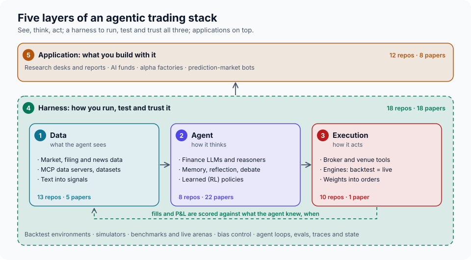

<!-- generated by tools/build.py from catalog/layers.toml; do not edit by hand -->
# The agentic trading stack

[← Home](../README.md) · [Component matrix](../docs/components.md)

Every agentic trading system, however it is marketed, is some arrangement of five layers. A map by layer shows which jobs a project does, which it leaves to you, and which nobody does well yet. Each layer page lists the repositories (with their license status), papers, articles and posts for that layer, with the failure modes to watch and notes for builders.

| Layer | The question it answers | Scope | Repos | Papers | Articles |
|---|---|---|---|---|---|
| [1. Data layer](data.md) | What did the agent know, and when did it know it? | Market, fundamental, filing and news data; connectors that hand data to an agent (MCP servers); datasets; and the step that turns text into signals. | 13 | 5 | 6 |
| [2. Agent layer](agent.md) | Given the signals, what is the call, and how is it argued? | Finance LLMs and reasoning models, single agents with memory and reflection, multi-agent decision architectures, and learned (reinforcement-learning) policies. | 8 | 22 | 3 |
| [3. Execution layer](execution.md) | How does a decision become a fill, safely? | Broker and venue tools that give an agent order authority, trading engines that run the same code in backtest and live, and pipelines that turn target weights into orders. | 10 | 1 | 7 |
| [4. Harness layer](harness.md) | Is the result real, and would we notice if it stopped being real? | Research and backtest environments, simulators and paper-trading gyms, benchmarks and live arenas, robustness and bias control, and the agent harness itself: loops, evals, traces and durable state. | 18 | 18 | 15 |
| [5. Application layer](application.md) | What end-to-end job does it do for a user? | Systems aimed at a use case that you can run as they are: research desks and reports, simulated funds and portfolio managers, alpha factories, and prediction-market bots. | 12 | 8 | 10 |

## How entries are placed

- An entry's **primary layer** is the job it does first; it is listed there. A repository that ships working code for another layer is cross-listed on that layer's page under "Also relevant". A README mention is not enough.
- **Data, Agent, Execution** are the pipeline: see, think, act. **Harness** wraps all three: it is how you run, test and trust them. **Application** sits on top: end-to-end systems aimed at a use case.
- When it is unclear whether something is an Agent or an Application, ask whether its point is *how* a decision is made (Agent) or *what job* it does for a user (Application).
- Surveys that span the stack are listed on the [home page](../README.md#surveys).
